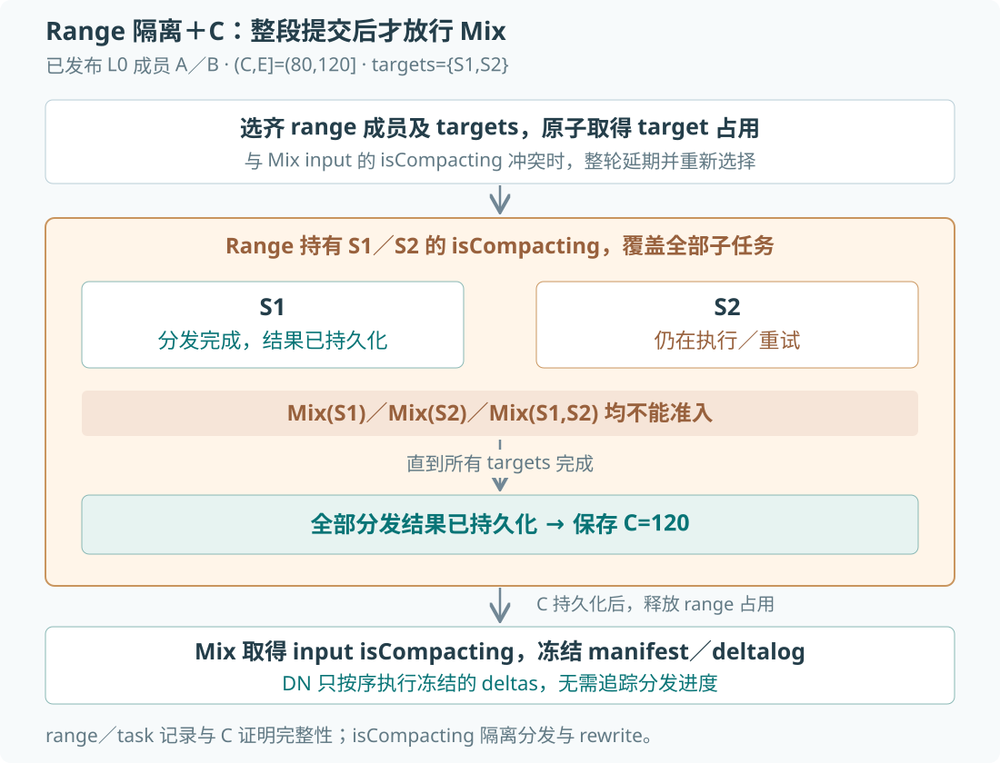

# Predicate delete 与 PK inplace-update

Phase 1 设计 · 2026-11-04 · 设计稿，尚未实现

## 1. 功能定义

本设计为 Milvus 引入 predicate delete 和 PK inplace-update。以下用 SQL 示意：

```sql
-- Predicate delete
DELETE FROM t WHERE age == 18 AND checked == false;

-- PK inplace-update
UPDATE t SET checked = true, name = 'reviewed' WHERE pk == 100;

-- Batch PK inplace-update
UPDATE t SET checked = true, name = 'reviewed' WHERE pk IN [100, 200, 300];
```

## 2. 解决的问题与收益

### 2.1 Predicate delete：省去前置 Query 与大批量 PK 搬运

当前非 PK delete-by-expr 先 Query 出命中 PK，再将 PK 列表写入 WAL。一条很短的表达式，可能展开成数千万个 PK，在查询侧、Proxy 和 StreamingNode 之间传输、缓冲。


既有压测中，1 亿行、12 CU、并发 Search／Insert 下，删除 2,000 万行耗时 **129.6 秒**；Proxy memory working set 从 **0.53 GiB** 升至 **1.41 GiB**，StreamingNode 从 **4.70 GiB** 升至 **9.51 GiB**。[实验报告](experiments/20261016-bulk-delete/report.md)

predicate delete 的预期收益是：**省去前置 Query 和大批量 PK 传输，降低前台查询、网络与缓冲成本。**

### 2.2 PK inplace-update：避免未修改 raw data 的额外 cache 驻留

当前 partial-upsert 为补齐完整新行，需要 Query 旧行。即使只修改 `checked`，也可能读取未修改的 vector、VARCHAR；随机 PK 分散在不同 CacheCells 中，又会将这些行所在的整块 raw data 载入 cache。**代价不止发生在请求执行期间：请求结束后，这些未修改数据仍可能占用内存。**


[旧行 Query／partial-upsert 实验](20261030-partial-upsert-query-memory-experiment-zh.md)使用 100 万行、768 维 vector、1 KiB VARCHAR、raw local format。随机读取 **1% 的行**，触及全部 **971 个 raw-vector CacheCells**；Query-only 冷读停止 **120 秒后**，对照调整后的 RSS 仍增加 **2.894–2.904 GiB**。真实 partial-upsert 首次增加 **3.027 GiB**。

PK inplace-update 的预期收益是：**不再为修改小字段读取完整旧行，避免由此拉入未修改宽列的额外工作集。**

### 2.3 PK inplace-update：减少整行重写及额外 vector 维护

当前 partial-upsert 还会将补齐后的完整行作为新版本 Insert，并 Delete 旧版本。只改一个 scalar 字段，也会重复写入未修改的 vector 和宽列，并增加后续 compaction、index build 的处理量。


PK inplace-update 的预期收益是：**避免 scalar 变更生成完整新行，减少未修改字段的重复写入，以及由此额外引入的 compaction 和 vector indexing 工作。**

## 3. 顶层设计：一条逻辑时间线，两条消费路径

客户端的 predicate delete 和 PK inplace-update 经 Proxy 写入 WAL。同一份操作随后进入两条链路：持久化链路保存变更并在后台形成新 segment，在线链路更新正在服务的数据。

```architecture
Client → Proxy → WAL
                 ├─ 持久化：L0 delta 模块（SN → MixCoord / DN 分发）
                                               → Segment deltalog
                                               → DN full rewrite → 新 segment
                 └─ 在线：Delegator → Growing / Sealed → Records → 查询
新 segment → 加载 base 与未物化后缀 → 接入在线路径
```

### 3.1 持久化链路：从操作到新 segment

L0 delta 模块中，SN Materializer 将 WAL 中的操作保存为 L0 delta files，MixCoord 接收输出并调度 DN，将变更分发到相关 segments。随后 DN 在 full rewrite compaction 中将变更写入新 segment。

### 3.2 在线链路：从操作到查询结果

Delegator 从 WAL 接收操作，分别交给 StreamingNode 本地的 Growing segments 和 QN worker 上的 Sealed segments。两者将更新或删除应用到所持有的数据，使后续查询看到字段变化和删除结果。

查询侧加载新 segment 后，接入在线链路并继续接收后续操作。两条链路由此衔接：同一份操作既影响当前查询，也进入后续加载使用的数据。

## 4. 功能约束与模块职责

### 4.1 功能约束

predicate delete 与 PK inplace-update 均允许对 unloaded collection 提交。loaded 时，在线消费者同步 apply 到适用 segments；unloaded 时，后续由 persistence、compaction 和 load replay 执行。API 在 WAL append 成功后返回；需要看到该操作的查询，必须等到相关 apply 完成，不要求返回时所有 replicas 已完成。

| 能力 | Phase 1 语义 |
| --- | --- |
| Predicate delete | 支持 `AND / OR / NOT / > / < / >= / <= / != / == / IN` 的受限 typed expression；整棵表达式、字段类型、常量和 NULL 语义均须通过校验 |
| PK inplace-update | 选行支持 `pk == constant` 和 `pk IN [constants...]`；所有目标 PK 应用同一组 assignments，可同时修改多个字段；对每个 PK 更新全部满足 scope、时间和存活条件的物理行，即 update-all-matches |
| 可更新字段 | INT8／16／32／64、BOOL、TIMESTAMPTZ、VARCHAR、普通标量 ARRAY；支持 nullable 字段的显式 SET NULL |
| 赋值方式 | 整 cell 常量 SET；ARRAY 也是提交整个新数组。不同字段的赋值互不覆盖 |
| 不支持 | 通用 UPDATE WHERE、算术赋值、读取旧值的 RHS、ARRAY append/remove 或元素 patch；JSON、VECTOR、TEXT、独立 FLOAT／DOUBLE 字段更新及嵌套／VECTOR／STRUCT 数组 |
| 特殊字段 | 不更新 PK、分区键、聚簇键、函数依赖／生成字段及 TTL 时间字段 |
| 无匹配行 | 不插入、不复活，操作对该 segment 无效果 |
| 请求边界 | 一次请求提交一个 UPDATE 或 DELETE，可包含多个 PK；不新增用户可组合事务，内部沿用现有 VChannel transaction 机制。既有 Upsert 内部事务保持原语义 |
| 物化方式 | 普通 full rewrite compaction；Phase 1 不做数据侧或 QN-local Consolidation |

例如 `SET values=[1,2,3,4]` 表达完整的新数组，而不是“在旧数组上追加 4”。`SET count=100` 受支持，`count=count+1` 不受支持。Proxy 可以保留直接化为 literal SET 的语法便利，但不能隐含查询旧值或新增 read-modify-write 语义。

复用现有 Delete API，合法表达式按以下路径分流：


路径在写入前选定，native append 开始后不因超时或 apply 失败回退到 query-PK。

native predicate 在 WAL ACK 时不知道实际命中数。`delete_count` 的 unknown 返回表达是尚需处理的接口兼容项；不为恢复计数增加前台查询，也不能将默认 0 宣称为实际删除数。

### 4.2 模块职责与协作

| 模块 | 输入与输出 | 模块职责 |
| --- | --- | --- |
| Proxy / WAL | API 请求 → WAL 消息 | 校验请求，提交逻辑 mutation |
| L0 delta（SN／MixCoord） | WAL 消息 → 目标 segment deltalogs | 生产 L0，提交 batch，调度 DN 分发到目标 segments |
| DN full rewrite | base＋deltalogs → 新 segment | 合并 base 与 deltas，写出替代 segment |
| Delegator | WAL／L0／buffer → segment | 在线 mutation 分发与 segment load 补齐 |
| Segment | base/index＋mutations → 查询结果 | 执行更新与删除，提供 overlay 读取 |

下图展示一个 delta 从 Proxy 进入后，如何经各模块分别作用于在线查询和 compaction 输出。


### 4.3 时间与进度的含义

| 记号 | 含义 | 维护位置 |
| --- | --- | --- |
| `row_ts` | 物理行的有效诞生时间，UPDATE 不改变它 | 行数据；导入沿用现有 commit-time 处理 |
| `mutation_ts` | mutation 的有效 WAL TimeTick；transaction 内取 CommitTxn TimeTick | WAL 和 delta record |
| `M` | VChannel 级 delta 持久化发布水位，即三类 delta 已完整持久化并提交的连续前缀的结束时间戳 | 持久化到 etcd，由 MixCoord 在 batch 提交事务中推进 |
| `C` | VChannel 级 delta 分发完成水位，即已完整分发至全部适用目标且分发结果已持久化的连续前缀的结束时间戳，`C≤M` | 持久化到 etcd，由 compaction 完成侧推进 |
| `H` | Query side 本次 load 的历史异步回放范围终点，即输入交接结束时间戳；所需历史 deltas 已完整入队，交接后固定 | Delegator／segment 加载期内存状态，不持久化 |
| `A` | Query side 历史异步 apply 的完成水位；`ts≤A` 的本次所需历史 deltas 均已执行完成 | segment 加载期内存状态，不持久化 |
| `TSafe / Q_TS` | TSafe 证明 channel 的实时可读进度；Q_TS 是查询实际使用的 MVCC timestamp | 查询准入与执行 |

DeleteCP 指定 deleteBuffer 可安全回收的删除前缀边界。对当前 VChannel 加载范围内的有效 L0 集合，[计算](../../internal/datacoord/handler.go)如下：

```text
DeleteCP = L0 非空 ? min(L0.StartPosition) : VChannel.seekPosition
```

DeleteCP 不是 M、C 或 apply 进度。Recovery CP 管理 WAL 恢复，不能替代上述契约。任一 record 的最大 timestamp 都不能单独证明前缀完整。

## 5. 模块详细设计与实现改造

### 5.1 Proxy / WAL：提交可重放的逻辑操作

Proxy 将用户请求转换为逻辑 mutation；WAL 保存操作并确定消费者使用的逻辑时间。

#### 5.1.1 请求到 WAL 消息

1. **校验与分流。** 在 WAL append 之前完成 Delete API 分流；point UPDATE 使用独立入口。对最终完整表达式做支持集判断，权限、schema 和 scope 校验均保留。
2. **提取与规范化。** UPDATE 接受 PK 等值或 PK IN 常量列表，以及 literal assignments。直接提取 PK 数组，复用 PK-delete 的 VChannel 路由和批量打包方式，无需前置 Query。写入前检查窄整数越界、VARCHAR `max_length`、ARRAY `element_type / max_capacity` 及元素有效性；TIMESTAMPTZ 沿用 UTC Unix microseconds 归一化。
3. **构造消息。** predicate delete 将字段名绑定为 field ID 和类型，构造 typed predicate；point UPDATE 直接携带 PK 数组和 typed assignments，不将 PK 等值／IN 条件编码为 expression AST，结构见 §5.1.2。PK、predicate 和赋值内容均放在 body，不因 Delegator 需要 BF 就搬到明文 header。
4. **打包与提交。** 按 VChannel 打包并 append WAL。非 transaction 消息以自身 WAL TimeTick 作为 mutation_ts；VChannel transaction 内的全部 mutations 统一以 CommitTxn.TimeTick() 作为 mutation_ts。点更新与删除不组成新的混合事务，同 ts 的多 PK records 必须完整保留。

#### 5.1.2 输出与契约

输出是包含操作范围和目标的 WAL 消息：predicate delete 携带 typed predicate，point UPDATE 携带 PK 数组与 assignments。每次提交必须明确 collection、VChannel、partition scope、schema 身份、目标字段和 typed 值。消息由消费者独立解释，不依赖 Proxy 已查出的 offsets 或主集群特有的 segment 布局。

**消息结构。** 沿用现有 WAL envelope：通用属性在 Properties，collection／schema 身份在 Header，业务内容在 Body。Header 编码在 `_h` property；Body 以 Protobuf bytes 保存为 payload，启用 cipher 时加密 payload。以下为拟新增消息的解码后逻辑结构，省略通用 version 字段；消息枚举和 Protobuf 字段号在实现时确定。

Predicate delete：`DELETE FROM t WHERE age == 18`，其中 age 的 field ID 为 102。

```text
Properties {
  message_type: PREDICATE_DELETE,
  vchannel: "v1", timetick: 100, txn_context: null
}
Header { collection_id: 10, schema_version: 7 }
Body {
  partition_scope: ALL_PARTITIONS
  predicate {
    unary_range_expr {
      column_info { field_id: 102, data_type: Int64 }
      op: Equal
      value { int64_val: 18 }
    }
  }
}
```

Point update：`UPDATE t SET checked = true, name = 'reviewed' WHERE pk IN [100, 200]`。primary_keys 直接使用现有 `schemapb.IDs` 表达 PK 数组，与 PK-delete 保持相同的字段组织；checked、name 的 field ID 分别为 103、104。

```text
Properties {
  message_type: UPDATE,
  vchannel: "v1", timetick: 110, txn_context: null
}
Header { collection_id: 10, schema_version: 7 }
Body {
  partition_scope: ALL_PARTITIONS
  primary_keys {
    int_id { data: [100, 200] }
  }
  assignments: [
    { field_id: 103, literal: { data_type: Bool, bool_value: true } },
    { field_id: 104, literal: { data_type: VarChar, string_value: "reviewed" } }
  ]
}
```

predicate delete 复用 [planpb.Expr](../../pkg/proto/plan.proto) 的受限节点。`UpdateBody` 内直接声明 `oneof target { primary_keys, predicate }`：primary_keys 使用 `schemapb.IDs`，predicate 使用 `planpb.Expr`。两者均为 Body 的直接字段，oneof 只约束互斥选择，不增加 `target {}` 消息包装。Phase 1 只接受 primary_keys，predicate 仅预留格式空间，不实现通用 UPDATE WHERE。

Delegator 直接解码 PK 数组做 BF，不需要理解 expression AST；assignments 保持可转发的 serialized bytes，由执行端解析。单 PK 等值请求同样使用长度为 1 的 PK 数组。`literal` 使用 §5.2.4 的 TypedValue；nullable 字段的 SET NULL 用显式 `null_value`，不以缺失 assignment 表达。

SET NULL：假设 name（field ID=104）是 nullable VARCHAR，`UPDATE t SET name = NULL WHERE pk == 100` 对应：

```text
Properties {
  message_type: UPDATE,
  vchannel: "v1", timetick: 120, txn_context: null
}
Header { collection_id: 10, schema_version: 7 }
Body {
  partition_scope: ALL_PARTITIONS
  primary_keys { int_id { data: [100] } }
  assignments: [
    {
      field_id: 104
      literal { data_type: VarChar, null_value: NULL_VALUE }
    }
  ]
}
```

`null_value` 复用 Protobuf 官方 Well-Known enum [`google.protobuf.NullValue`](https://protobuf.dev/reference/protobuf/google.protobuf/)，其枚举值为 `NULL_VALUE = 0`。TypedValue 的 `oneof value` 显式记录选中的分支；即使 null_value 的值为 0，显式设置后也与“未设置任何 value 分支”不同。参见 [oneof presence 规则](https://protobuf.dev/programming-guides/field_presence/)。

| 消息内容 | oneof value 状态 | UPDATE 语义 |
| --- | --- | --- |
| `literal { data_type: VarChar, null_value: NULL_VALUE }` | 选中 null_value | SET NULL |
| `literal { data_type: VarChar, string_value: "" }` | 选中 string_value | 设置为空字符串 |
| `literal { data_type: VarChar }` | 未选中任何 value 分支 | 缺少赋值，reject |
| 没有该字段的 assignment | 不涉及该字段 | 不修改 |

校验与执行必须检查 **oneof case**，不能只判断 `GetNullValue() == 0`：未设置 null_value 时，getter 也可能返回默认值 0。assignment 存在但 value 未设置时，必须在 WAL append 前 reject，不能当作 SET NULL；消费端也不得将未设置的 value 默认为 NULL 或静默忽略。Protobuf 负责保留分支 presence，缺值拒绝由业务校验实现。

**有效 TimeTick。** 在线 apply、L0 delta records 和 compaction 使用同一个 mutation_ts：

```text
mutation_ts = 非 transaction ? message.TimeTick() : CommitTxn.TimeTick()
delta.ts    = mutation_ts
```

例如同一次 UPDATE 请求在 v1 内被切成两条消息：

```text
物理 WAL：BeginTxn@90 → UPDATE@91 → UPDATE@92 → CommitTxn@100
消费与 L0：两条 UPDATE 的全部 delta records 均使用 mutation_ts=100
```

现有 [transaction assembly](../../pkg/streaming/util/message/builder.go) 在消费时将 transaction 及其 body messages 的 TimeTick 统一设为 CommitTxn.TimeTick()。这是 WAL 逻辑时间，不是客户端提交时间或 append 完成的 wall-clock 时间；Body 不再保存另一套 mutation 时钟。

**CDC。** Predicate delete 与 PK inplace-update 的逻辑变更完整由 WAL message 表达。Proxy 不查询命中行或 offsets，也不感知目标 segment ID、物理文件；不通过 WAL 之外的额外业务 RPC 指示 SN、DN 或 MixCoord 修改数据或 metadata。主备分别消费逻辑 WAL，独立完成行定位、执行和物化，不依赖主集群额外执行的动作。WAL append 本身可经 RPC 到达 SN，但不构成 WAL 之外的写入路径。依据：[Milvus CDC 契约](../agent_guides/streaming-system/replication/replicate.md)。

若备集群 SN 不认识新增 MessageType，其 [RPC append 入口](../../internal/streamingnode/server/service/handler/producer/produce_server.go)会在调用 `wal.AppendAsync()` 前返回 `unsupported message type`。该消息不写入备集群 WAL，CDC 返回复制失败，复制 checkpoint 不越过该消息。

#### 5.1.3 当前实现与改造

**可复用。** 现有 [PK-delete 写入链路](../../internal/proxy/dml/task_delete_streaming.go)已支持 PK 数组路由与打包、WAL 消息封装；[WAL 提交机制](../../internal/distributed/streaming/internal/producer/producer_task.go)已有 VChannel 内部 transaction 和 append 成功返回语义，无需重建。

**需增强。** 新增 predicate-delete／point UPDATE 消息及 typed 赋值、显式 NULL 校验，使两类操作无需前置 Query 即可进入 WAL。接通新消息的 CDC 复制与消费；CDC 部署的主备及执行节点均须支持新消息后才能启用。

### 5.2 L0 delta：生产、原子发布与分发

本模块将连续 WAL 中的 mutations 持久化为 L0 delta files，原子发布为可调度的 batch，再分发到目标 segment。SN 负责区间切分与文件准备；MixCoord 中的 DataCoord 负责 batch／进度 metadata 提交、L0 compaction 调度及分发期间的 target 隔离，DN 执行分发。


#### 5.2.1 生产侧：SN sync

Materializer 接收同一 VChannel 已确认、重排后的连续 WAL 消息流，由 SN 按 sync 策略切为首尾相接的 ranges，并为每个 range 生成一个 batch。每个 batch 覆盖 `(P,E]`：P 是前一批的结束边界，E 是本批 WAL 输入的完整消费边界。收集区间内全部 partition scopes 的 PK DELETE、predicate DELETE、UPDATE；即使区间内只有 Insert／TimeTick、没有任何 delta，也能确认该区间的 delta 输入完整。

有 delta 时，按消息携带的 partition scope 分组；ALL_PARTITIONS 保留为一个 scope，不展开为具体 partition 列表。每个 scope 内按 rolling 策略生成一个或多个 L0。保存原始指令，不提前求值，也不将更新压成最后值；没有 delta 时，batch 的成员集合为空，不写空文件。

**Sync 触发。** 容量、等待时间、显式 Flush 等条件触发 sync。schema-change fence 是其中的强制 cut：切出旧 schema 的 delta buffer 并触发 sync，后续 delta 进入新 schema 的 buffer，保证单个文件不跨 schema_version。它不改变区间完整性、提交顺序或 M 的推进规则。

SN 输出本批完整覆盖区间、L0 files 和成员 metadata，供 MixCoord 提交。文件准备完成尚不表示该 batch 可以被调度。

Insert files 可独立 sync，保留前序 L1 注册依赖，不要求所有 L1 flush。

#### 5.2.2 原子发布：batch 与 M

MixCoord 以一个 batch 的全部成员为原子可见单位。提交前，L0 compaction 调度侧不得选取该 batch 的任何成员；提交后，调度侧可以采用该批完整输出。

发布分三步：

1. 建立 PREPARING attempt，分批写 files、L0 metadata 和成员引用，尚不可消费。
2. 全部输出持久化、完整区间确认、成员固定后置为 PREPARED。
3. 一个 etcd 条件事务校验 batch／M revision 及 `batch.start==M`，同时写 `COMMITTED＋M=batch.end`。

提交必须满足以下规则：

- **Contiguous。** `(P,E]` 覆盖全部 partition scopes 的三类 delta；区间边界来自完整 WAL 消费进度，文件中 records 的 min/max ts 只是内容统计。提交时必须有 `P=M`，不能留下 hole。
- **Ordered。** batch 按覆盖区间先后提交，不能越过未完成区间推进 M。文件准备可以并行；后续文件写完，不代表后续区间可以提前供调度侧采用。
- **M 随 range 推进。** 提交成功后 `M=E`，有无 delta 都一样。例如 `(120,200]` 没有 delta，提交空成员 batch 后仍将 M 从 120 推进到 200。空 TimeTick 可以合并为较大区间提交，不必每个 tick 写一次 metadata。

**Batch metadata。** VChannel 级 M／C 和 batch 使用以下布局：

```text
datacoord-meta/delta-channel/{collectionID}/{vchannel}/progress/M
datacoord-meta/delta-channel/{collectionID}/{vchannel}/progress/C
datacoord-meta/delta-channel/{collectionID}/{vchannel}/batches/B42
  → {
      coverage_start_exclusive: 80,
      coverage_end_inclusive: 120,
      state: PREPARING | PREPARED | COMMITTED | DROPPED,
      l0_segments: [
        {partition_id: 10, segment_id: 10001},
        {partition_id: -1, segment_id: 10002}
      ]
    }
```

M、C 用两个 KV，由各自完成侧更新。batch header 直接保存成员列表；成员继续通过既有 L0 SegmentInfo／FieldBinlog log IDs 或 storage manifest 找到 N 个文件，不把全部 paths 填进 progress，也不改物理路径规则。列表需满足 etcd 单 value／request 限制。

batch ID 标识稳定的持久化 attempt，废弃重建使用新 ID。消费者只枚举 COMMITTED 且结束边界不超过 M 的成员；单个文件存在或 `endTs≤M` 不构成采用依据。完全已发布区间不重发，gap／交叉 overlap 不静默通过。[etcd transaction](https://etcd.io/docs/v3.6/learning/api/#transaction) 原子更新的是 batch 的调度可见状态与 M；文件及 L0 metadata 可分批写入，不依赖 S3 rename。

原子性约束是调度侧对 batch 成员集的 all-or-nothing 采用，不要求生产侧所有文件同时写成功；这里采用 [atomic flush](https://github.com/meta/rocksdb/wiki/Atomic-flush) 的准备与提交分离原则。

#### 5.2.3 消费侧：L0 compaction 分发

MixCoord 从 `(C,M]` 中选择一个完整的 dispatch range `(C,E]`，确认其全部已提交 L0 成员，调度 DN 将逻辑指令分发到目标 segment。L0 不执行 predicate／UPDATE；PK DELETE／point UPDATE 可用 BF，predicate DELETE 发至 scope 内全部适用 targets。

**Phase 1 取舍。** 采用 range 隔离＋C：锁住本轮全部适用 target sealed segments，直到整个 range 的分发结果持久化、C 推进后才允许它们进入 Mix。接受较长的 Mix 等待，避免为每个 segment 持久化一份独立的 delta 分发水位。

分发与 Mix 准入使用以下协议：

1. **确定并占用 targets。** 在与 Mix 共用的准入临界区内，按 scope 和时间资格选齐、校验本轮全部 targets，原子检查并设置它们的 `isCompacting`。有冲突或 target 已被替换，则整轮延期、重新选择；不能跳过被占用的 target 后就宣布完成。
2. **在 range 占用下分发。** target 占用由 range 持有，覆盖其全部 L0 成员与分发子任务；不能等 BF 命中后才决定锁谁。子任务可分别完成并提交结果，但任何单个 L0／子任务的完成都不能提前释放 targets。这里采用 [compaction 输入隔离](https://github.com/apache/kudu/blob/1.18.1/src/kudu/tablet/tablet.cc#L1724)的原则，具体占用由本方案的 range／task 生命周期管理。
3. **完整提交后释放。** 全部适用分发结果持久化后，保存 `C=E`，再释放 range 的 target 占用。此后 Mix 才能原子取得自己的 input 占用，并冻结各 input 的 manifest／deltalog 文件集合。



例如 `C=80、E=120`，range 的 L0 成员为 A/B/C：只有三个成员都完成全部适用 targets、结果持久化，才能推进 `C=120`。空 range、无适用 target 或 BF 无命中也计入完成判断，无须写假文件或单独更新 segment progress。锁负责隔离，range／task 完成记录与 C 负责证明完整性；只有锁本身不能证明前缀完整。

| 路线 | 完整性与 Mix 准入 | 代价 |
| --- | --- | --- |
| Phase 1：range 隔离＋C | range 持有全部适用 targets 的 `isCompacting`；全部结果提交并推进 C 后放行 Mix | 任一子任务未完成，整个 target 集合继续等待；涉及 10,000 个 targets 时，它们的 Mix 都等待本轮完成 |
| 替代：per-segment 分发水位 | 每个 segment 持久化已完整收到的 delta 区间终点；零输出也推进，Mix 根据各 input 水位检查输入完整性 | 增加 progress KV 更新与恢复逻辑。有文件输出时可随现有 metadata 提交；零输出 targets 原本无需更新，现在也要写入进度 |

两条路线都需要持久化实际 deltalogs／manifest 引用。新增写放大主要出现在稀疏 PK 操作：本轮覆盖很多 targets、只有少量产生文件时，逐 segment 显式推进会让零输出 targets 也产生 metadata 写入。进度可以按 range 合并提交，不必每条 mutation／每个 TimeTick 都写；批量提交减少 RPC 次数，不消除 KV 更新的复制、持久化成本。predicate DELETE 向全部适用 targets 分发指令，这些 targets 原本就有文件引用更新，progress 的边际写入成本相对较小。

#### 5.2.4 输出与契约

本模块交付已提交 batch 与 L0 files、目标 segment 的 deltalogs／文件引用，以及 VChannel 的持久化水位 M／C。

消费者只使用权威已提交成员；L0 分发按完整区间推进，`C≤M`。一个区间的全部 L0 对全部适用 targets 完成分发、结果持久化之后，才能跨过该区间。

调度侧必须向后续 rewrite plan 提供完整适用前缀，不能把后面的已分发 records 与遗漏前序 delta 的输入视图交给执行端。例如先物化 UPDATE@100、遗漏 DELETE@90，会使旧 predicate 在更新后的 base 上得到错误结果；保留旧日志或仅阻止 C／DeleteCP 推进都不能修复这次错误 rewrite。已提交 batch／file-set 和 M／C 建立完整性依据，§5.2.3 的 range 隔离阻止 rewrite 读到尚未完成的分发输入，DeltaExecutor 不再重复验证。这里的 ordered 是逻辑前缀的交付顺序，不要求所有物理任务串行完成。

Growing 的覆盖继续受既有 seal 和安全调度条件保护；target 被 Mix 替换时仍须保持后缀覆盖。C 持久化前保留完成依据。load 不直接消费 C，也不新增每个 sealed segment 的 `dispatch_ts`；它由 Delegator 取得正确 manifest／deltalog／L0／buffer 输入。

采用 Parquet 外层列＋Protobuf payload，格式面向 load、forward 和 ordered replay。一个文件只属于一个 collection／VChannel／partition scope，并共用一个 schema_version；partition scope 可为 ALL_PARTITIONS。旧文件保留 legacy reader adapter，不要求升级时重写。

**FileMetadata 是一个 L0 delta file 的文件级 metadata**，文件内所有 records 共用，只保存一次。**DeltaRecord 是文件中每行 delta 的逻辑格式**，`ts / op_type / pk / payload` 分别对应 Parquet 的列；只有 payload 列保存 serialized Protobuf bytes。以下为逻辑 schema，具体 wire 字段号在实现中确定。

```text
FileMetadata {
  delta_format_version, schema_version,
  collection_id, vchannel, partition_scope, pk_type
}

DeltaRecord {
  ts, op_type,
  pk: nullable INT64 / STRING,
  payload: nullable BYTE_ARRAY  // serialized Protobuf
}
```

| op_type | pk | payload |
| --- | --- | --- |
| PK_DELETE | 目标 PK | 无 |
| PREDICATE_DELETE | 无 | `{ predicate: TypedExpr }` |
| POINT_UPDATE | 目标 PK | `{ assignments: Assignment[] }` |
| PREDICATE_UPDATE | 无 | `{ predicate, assignments }`，仅预留 |

PK IN 请求在 delta file 中按 PK 展开为多条 POINT_UPDATE records，各自携带同一组 assignments；单条 record 仍对应一个 PK。

```text
Assignment {
  field_id
  oneof rhs { literal: TypedValue; expression: TypedExpr /* reserved */ }
}
TypedValue {
  data_type
  oneof value {
    int64_value; bool_value; double_value; string_value;
    timestamp_us_value; array_value: TypedArrayValue;
    null_value: google.protobuf.NullValue
  }
}
TypedArrayValue { element_type; values; element_validity }
```

`delta_format_version` 选择协议 reader，schema_version 绑定表达式解释上下文。INT8／16／32 的类型信息不能因使用 int64 承载而丢失；double literal 可用于 predicate，不扩大 UPDATE 类型范围。`false / 0 / "" / [] / NULL / 未赋值` 均须保留 presence，复用现有 typed messages 并补齐显式 NULL。

**完整混写文件示例。** 以下三次操作写入同一个 L0 delta file，count 的 field ID 为 105：

```sql
UPDATE t SET count = 20 WHERE pk == 100;  -- mutation_ts = 90
DELETE FROM t WHERE count == 20;         -- mutation_ts = 95
DELETE FROM t WHERE pk == 200;           -- mutation_ts = 100
```

`F1.parquet` 的解码后逻辑内容如下。示例将 payload bytes 展开为 Protobuf 字段，便于阅读；文件仍按 Parquet 列式存储。

```text
FileMetadata {
  delta_format_version: 1
  schema_version: 7
  collection_id: 10
  vchannel: "v1"
  partition_scope: ALL_PARTITIONS
  pk_type: Int64
}

Records [
  {
    ts: 90, op_type: POINT_UPDATE, pk: 100
    payload: {
      assignments: [
        { field_id: 105, literal: { data_type: Int64, int64_value: 20 } }
      ]
    }
  },
  {
    ts: 95, op_type: PREDICATE_DELETE, pk: null
    payload: {
      predicate {
        unary_range_expr {
          column_info { field_id: 105, data_type: Int64 }
          op: Equal
          value { int64_val: 20 }
        }
      }
    }
  },
  { ts: 100, op_type: PK_DELETE, pk: 200, payload: null }
]
```

这里共三行 DeltaRecord，分别是 point UPDATE、predicate DELETE、PK DELETE；FileMetadata 不重复出现在各行中。`pk: null`／`payload: null` 表示相应 Parquet 列的空值。

Delegator 加载 L0 后须能遍历 ts/op/scope、使用 PK 做 BF，并重复转发 payload bytes；执行端才解析 predicate／assignments。外层 `op_type` 直接选择路由和执行分支。predicate UPDATE 和 expression RHS 仅预留格式；Phase 1 收到这些分支时返回不支持，不能静默跳过。

#### 5.2.5 Crash recovery、GC 与升级切换

每个 VChannel 恢复时先串行整理 M、C 和 batch，再启动新 materialization：

| 持久化状态 | 恢复动作 |
| --- | --- |
| PREPARING | CAS 标 DROPPED；未发布产物交 GC，区间从 WAL 重做 |
| PREPARED | 确认衔接 M，复用输出，仅重试最终提交 |
| COMMITTED | 采用已提交结果，不重复 sync；尚未被 C 覆盖则继续分发 |
| COMMITTED 且 `C≥batch.end` | 标 DROPPED，交异步 GC |
| DROPPED | 继续清理，不恢复任务 |

未完成 dispatch range 的区间、L0 成员、targets 和任务归属进入持久化 task metadata。恢复先依据这些记录重建 target 占用，再开放 Mix 准入；`isCompacting` 的内存值不能作为恢复后的唯一依据。单个子任务失败或清理，不释放所属 range 的 targets；先恢复／重试完整分发。C 已覆盖 range 时，可据此恢复完成状态并清理占用，不能因迟到的清理误释放另一任务持有的 targets。

提交成功但响应丢失时，以恢复读到的持久化状态为准。所有状态转换使用 CAS，DROPPED 不可复活。旧进程虽已消失，在途远端请求仍可能竞争；recovery CAS 失败后重读并按新状态处理。若旧请求已提交，则采用该结果，不能换 revision 后继续强写 DROPPED。未知状态、缺失引用或不一致 coverage 应报错保留证据，不能一概清除。[etcd API guarantees](https://etcd.io/docs/v3.6/learning/api_guarantees/)描述了这类提交结果不确定性。

成功 batch 的退出顺序是“分发结果持久化 → C 持久化 → batch 标 DROPPED → 异步 GC”。C 覆盖后，batch metadata 可退出，其成员 L0 files 仍按原生命周期、retention 和 pin 保护回收，不要求等物理文件全部删除。

废弃 attempt 不推进 M／C。其垃圾清理先 files、再 L0 metadata、最后 batch metadata，或先持久化转交清理责任；任何失败都保留继续清理所需引用。未登记、迟到文件的 orphan 覆盖需接入现有 [GC](../../internal/datacoord/garbage_collector.go) 和 [storage path contract](../agent_guides/storage/path_contract.md)。

**升级切换。** 先停止继续产生 legacy 协议输出、收齐旧 buffer／在途 materialization，再按旧机制完成 legacy L0 的全部分发和持久化提交，随后开放新 batch 分发。旧 reader 保留，M／C 从明确切换点接续；不按旧文件最大 ts 猜测，也不等待旧文件物理 GC。该门槛和恢复后的接续须持久化。

#### 5.2.6 当前实现与改造

**可复用。** [L0 Materializer](../../internal/streamingnode/server/wal/vchannel/l0materializer/wal.go) 的有序 buffer、输出流程，[delta reader/writer](../../internal/storage/serde_delta.go) 的 Parquet／legacy reader，以及 [L0 task](../../internal/datacoord/compaction_task_l0.go) 的目标筛选、结果提交和生命周期管理。现有 [compaction 调度](../../internal/datacoord/compaction_inspector.go)已有 input `isCompacting` 与 channel 级 L0／Mix 执行互斥；L0 的 input 标记目前仅覆盖输入 L0。

**需增强。** 支持三类 delta 的完整区间 batch、batch／M 原子提交、空区间推进和 schema-change fence。将 L0／Mix 的排斥细化为完整 range 的 target 占用，补齐持久化任务归属与恢复、C 提交后释放及 Mix 文件集合冻结；这些新增保证不能由当前单 task 的 channel 互斥直接推出。

### 5.3 DN full rewrite：按序物化并替换 segment

DN full rewrite 读取各 input segment 的 base 与适用 deltas，执行更新和删除，将存活行写为 replacement segment。

#### 5.3.1 输入到重写输出

MixCoord 按 §5.2.3 的协议取得 input segments 的 `isCompacting`：未完成的 dispatch range 占用这些 inputs 时，Mix 不能准入；取得占用后，从已提交 metadata 冻结各 input 的 manifest／deltalog 文件集合，生成 plan。占用保持至 replacement 输出 metadata 提交完成，L0 不能在此期间继续向这些 inputs 追加 delta。

```text
完整 range 分发提交，C 已推进 → 释放 range 占用
  → Mix 原子取得 S1、S2 的 isCompacting，冻结输入
  → S1：base₁ ＋ pending deltalogs₁ → 按序执行
    S2：base₂ ＋ pending deltalogs₂ → 按序执行
  → 合并写出 replacement，提交后释放 Mix 占用
```

**DN 无需追踪 delta 分发进度。** 输入完整性由上游 range 提交与 C 保证，`isCompacting` 阻止 L0 继续向这些 inputs 追加 delta，或其他 rewrite 替换这些 inputs。DN 只按各 input 的冻结文件集合建立 DeltaExecutor，按 `mutation_ts` 执行尚未消化的适用 deltas；不读取 M／C、不等待新的 L0 分发，也不新增 segment-level progress metadata。不同 inputs 的 base、行时间范围及 pending records 可以不同，不要求 base 对齐。

DeltaExecutor 按 input segment 创建。mergeSplit 为 S1 创建 executor₁，处理完 S1 后释放，再为 S2 创建 executor₂；mergeSort 为各 input 保持独立 executor，随 reader 交错执行。每个 executor 只处理本 input 的 rows 和 deltas，offsets／执行状态不跨 input 复用。

一个 input 可拆为多个 data batches，每批均按序执行该 input 的整段适用 mutations，直到所有 batches 处理完成。多个 inputs 可共用 writer；输出 segment 的合并／拆分不改变 executor 的作用域。

DeltaExecutor 复用既有类型与 compaction 数据访问能力，实现同一受限表达式、literal SET、NULL 和时间资格；predicate 仅 TRUE 时删除。

#### 5.3.2 DROP FIELD：block-and-drain gate

DROP FIELD 会移除历史 mutation 求值所需的数据。即使旧列已被读入本次 rewrite，仍可能有引用它的 delta 尚在 message queue、SN buffer 或 L0 中；若先输出不含旧列的 replacement，这些 delta 后续到达时就无法执行。因此，物理删列必须经过 block-and-drain gate。

**Gate 契约。** 对同一 collection 的 drop-target field ID，只要仍有一条 fence 前已接受、引用该字段的 delta，尚未向全部适用 segments 完成持久化交付，就禁止物理删列 rewrite 准入。判断覆盖 message queue、SN buffer、L0 和在途 dispatch，不能仅以当前待调度 L0 列表为空作为依据。已物化进 base 的变更无需重新写入 deltalog；BF 无命中的 target 也不必写空文件，由完整分发的覆盖证明确认完成。

```text
Block：建立 DROP fence，新 mutation 不得再引用 c
  → Drain：旧 delta 继续消费、sync、分发，直至全部适用 targets 持久化交付完成
  → Rewrite 准入：取得 inputs 的 isCompacting，固定 manifest／deltalog 文件集合
  → 执行：保留旧列参与按序 delta execution，输出时再移除 c
```

Block 由 schema fence 和 Proxy→SN 的 schemaVersion 校验关闭新引用，其他字段的 mutations 继续接受。Fence 前合法进入 WAL 的旧 mutation 仍须执行，不能因 latest schema 已不含 c 而被拒绝或跳过。Drain 期间，旧消息的消费和 L0 分发继续推进；不得提前占住会阻止分发的 `isCompacting`，以免 rewrite 等待 delta、分发又等待 rewrite 释放占用。

精细 gate 只等待 drop-target field 的历史依赖；允许更保守地等待整个 VChannel 的 `C ≥ x`，其中 x 是该业务 VChannel 上 DROP fence 的本地 WAL TimeTick，`C ≤ M` 同时保证此前的 sync 完整性。多 VChannels 分别检查各自边界，不直接使用 CChannel 的 TimeTick。MixCoord 将本次 write schema 与对应 fence 关联后判定准入，Segment 无需保存历次 DROP 的 timestamp。

**Execution schema 与 write schema 分离。** Execution schema 保留输入物理列中历史 deltas 依赖的字段及类型；reader 不能先按 latest schema 排除 dropped field。Phase 1 可以读取全部输入物理列，完成每个 input 的有序 delta execution 后，再按 write schema 投影并写出存活行。

以下按单个 VChannel 的 TimeTick 示意，S1 中 `pk=1, c=5`：

```sql
UPDATE t SET c = 15 WHERE pk == 1; -- @110
DELETE FROM t WHERE c == 5;       -- @120
ALTER TABLE t DROP COLUMN c;      -- @130
```

Gate 放行后，DeltaExecutor 先将 c 更新为 15，再执行 DELETE；该行不命中，输出时保留该行并移除 c。若没有 UPDATE@110，则 DELETE@120 删除该行。不能先删列，再尝试补算迟到的历史 delta。

这个 gate 覆盖所有实际移除旧列的 rewrite，包括普通 Mix、Sort、clustering 和 [bump-schema rewrite](../../internal/datanode/compactor/bump_schema_version_compactor.go)。[ClickHouse](https://github.com/ClickHouse/ClickHouse/blob/master/src/Storages/MergeTree/MergeTreeData.cpp#L13296) 会拒绝删除仍被未完成 mutation 引用的列；这里采用其历史依赖保护原则，将 gate 放在物理删列 rewrite 的准入处。

#### 5.3.3 Backfill：逻辑等价物化与列值覆盖

**Internal backfill。** 当前 [BumpSchemaVersionCompaction](../../internal/datanode/compactor/bump_schema_version_compactor.go) 不只生成 function outputs，也会物化缺失普通列；移除旧列则走 full rewrite，并遵守 §5.3.2。

普通列的 NULL／default 物化，在同一 schema 下不改变逻辑值：

```text
物化前：age 没有物理列，reader 返回 default=18
物化后：age 物理列保存 18
```

这类逻辑等价物化不需要额外作为 UPDATE 排入 delta 时间线，也不会改变 predicate 的命中结果；已有 updates／deletes 仍须保留。当前 function-output 物化支持 BM25 的 SparseFloatVector 和 MinHash 的 BinaryVector，均不在 Phase 1 predicate／UPDATE 的支持范围内。若将来 internal backfill 改为覆盖已可见的 scalar 值，则同样需要下面的顺序契约；`isCompacting` 和 manifest commit lock 本身不提供 DML 顺序。

**External backfill。** Spark 基于 snapshot prepare 列文件和 manifest，随后通过 [CommitBackfillResult](../../internal/datacoord/services_commit_backfill.go) 提交。每最多 512 个 segments 形成一个 `BatchUpdateManifest V2`，每批获得 CChannel 所在 PChannel 的 TimeTick；整个 Spark job 没有统一的业务 mutation timestamp，也不保证 job 级原子发布。

```text
CreateSnapshot（请求带 TTL 的 compaction protection）
  → Spark prepare 列文件和 manifest
  → CommitBackfillResult：分批 append CChannel WAL
  → FastAck → MixCoord/DataCoord callback 发布 metadata
  → API 返回成功；业务 DML 仍可能尚未 consume／apply
```

CChannel 是集群的 Control Channel；本路径不向 collection 的业务 VChannels 写入对应消息或 barrier。SN 处理通用 WAL 持久化、恢复和 broadcast ACK，不在本地 segments 上执行这些列值变化。Snapshot 的 compaction protection 在 TTL 内保护输入 segments 不被 full rewrite 替换，但不阻塞 DML 或 L0 分发。因此，这条结果发布链路没有建立 backfill 与业务 deltas 的相对执行顺序，不能直接比较两侧 TimeTick 来判定哪条 mutation 更早。

External backfill 的 `coalesce / overwrite / replace` 可以改变逻辑列值。若历史 predicate 尚待回放，替换 base 会改变其求值依据：

```text
初始：S 的所有行 age=20，row_ts<100
DELETE@100 WHERE age==18：在线执行不命中
External backfill 发布 age=18 的列数据
后续 DN 回放 DELETE@100：若读取 backfill 后的 base，所有行会被误删
```

PK-only UPDATE 虽不重新选择 predicate 命中行，但与 backfill 修改同一 cell 时，执行次序仍决定最终值；当前没有契约规定应采用哪个次序。现有 delete-by-expr／partial-upsert 的 Query 也会受 backfill 可见性影响，但 WAL 已固定 PK 集合或完整新行，compaction 不再重算原表达式。直接 PK-delete 不依赖被 backfill 改写的非 PK 列值。

**兼容性待决。** External backfill 与新 deltas 的顺序及准入协议尚未定稿。暂停新写、等待 TSafe 或 C 追平都不能消除尚未物化的历史 predicates；manifest commit lock 也只能保护引用发布。现有 external callback 还通过 [UpdateManifestVersion](../../internal/datacoord/ddl_callbacks_batch_update_manifest.go) 绕过该锁，版本号递增不能证明引用完整。若允许共存，必须为业务 VChannels 建立逻辑生效边界，并衔接边界前的 delta 执行／物化、backfill 状态发布和后续回放；Phase 1 的 collection 级功能互斥是候选方案，约束须覆盖可回放历史，不能只检查当前运行的任务。

#### 5.3.4 输出与契约

输出更新后的存活行及兼容的 base/index 元数据。删除行不写出，已消化的 deltas 不再作为 pending deltalogs 携带到输出。新 segment 加载时，由输入组装与 overlap 处理排除已消化操作、补齐尚未物化的后缀；初始 Records 可为空，加载后缀后会再次积累 histories／deletes。

full rewrite 可改变 offsets，并按既有流程构建和加载新 segment；不承诺复用旧 vector 文件或 ANN index。

普通 insert flush 不产生这个 mutation 消化边界。初始 segment 必须加载全部适用历史，不能用 flush／seal 时间或 DmlPosition 跳过 deltas。

row_ts 保持有效诞生时间。Mix 输出的 StartPosition／DmlPosition timestamp 优先按各输出 insert logs 的实际最小／最大有效行时间计算；缺少统计时使用输入最小 Start／最大 Dml 的保守范围，并保留导入 commit-time 处理。这些位置还承载 WAL／恢复信息，不能作为字段更新时间或判定 delta 已消化范围的依据。

后续 [L0 目标筛选](../../internal/datacoord/compaction_task_l0.go) 仍按 scope 和有效起始时间选择目标，不要求两个完整时间区间相交；[Mix 输出 metadata](../../internal/datacoord/meta.go) 保留这一筛选所需的时间范围。新 segment 创建得晚不能让旧行漏掉尚未分发的删除。

replacement 复用 §5.4 的加载交接：即使旧 QN 已执行到 @120，而本次 rewrite 只消化了截至 100 的完整输入，新 segment 也必须从自身 deltalog、适用 L0、buffer 和 catch-up 收齐 `>100`。该操作不必仍在内存 buffer 中。旧 segment 及 Records 由原有 pin／lease 保护，替换且使用者退出后释放。

full rewrite 折叠的更新历史不随新 base 保留。沿用当前 Milvus 的历史查询边界，不新增跨 rewrite 的 UNDO／time-travel；在途请求继续由旧 segment 生命周期保护。

DeltaExecutor 消化 plan 中的适用 pending deltas，不重放已被 base 消化的操作。rewrite 提交后，后续尚未分发的 ranges 按当前 targets 选择 replacement segment，不能再将其结果提交给已退出的 inputs。

#### 5.3.5 当前实现与改造

**可复用。** [Mix compactor](../../internal/datanode/compactor/mix_compactor.go) 的数据读取、重写输出流程，以及 [EntityFilter](../../internal/compaction/entity_filter.go) 的 PK-delete／TTL 处理。

**需增强。** 增加受限 DeltaExecutor，让 Sort、Mix、clustering 和 schema rewrite 在调度侧固定的完整输入上按序执行 predicate delete 与 UPDATE；接通 range／Mix 准入互斥，保证重写期间的输入稳定。分离 execution schema 与 write schema，并在所有物理删列路径接入 §5.3.2 的 block-and-drain gate，保护尚待执行的旧字段依赖。

另需补齐 §5.3.3 的 external backfill 顺序／准入协议与 manifest 发布对接。

### 5.4 Delegator：在线分发与加载交接

Delegator 将在线 mutations 送到适用 segments，并在 segment load 时组装历史输入、完成与实时链路的交接。

#### 5.4.1 在线分发与 load 数据流

三类操作进入同一个有序分发入口。PK DELETE／point UPDATE 解码外层 PK 后做 BF；predicate 不在 Delegator 求值，保留序列化 payload，转发到 scope 内适用 segments。Growing 执行层虽然在同一 SN 进程中，仍需解析并执行 payload。共享 bytes 保留至后续 loading segments 不再需要；某个 Growing 已执行不构成释放依据。

加载复用现有交接流程，将三类 delta 一并纳入：

```text
加载 base 和 segment 自带 deltalogs
  → 补充适用 L0 → 补充 Delegator 实时 buffer
  → catch-up 加载期间新输入
  → 最终交接至固定 H，加入 distribution
  → >H 的实时输入继续进入同一执行序列
```

历史数据可并行读取、解码并入队，执行仍按顺序。H 固定本次 load 的历史范围终点，只证明输入交接完整；A 随该历史输入的实际异步 apply 推进，追到 H 即历史完成。二者均为 query side 加载期的内存状态，不是 compaction 进度或持久化 segment metadata。

**重叠处理。** segment deltalog、L0 和 buffer 可能重复表示同一操作。统一 apply 入口只跳过已完整执行的前缀：先完成 `(80,120]`，再消费 `(100,150]` 时跳过 `≤120`，执行其后部分。同 ts 的所有 records 完成后才能推进水位；无命中区间也随完整输入的执行完成而完成。

#### 5.4.2 输出与契约

向执行端交付有序 mutations；load 还交付固定历史终点 H，并由执行端维护实际完成水位 A。Delegator 是 query side 的输入提供端，负责向 segment 交付完整适用前缀并保持逻辑顺序。在线分发的成功表示实际 apply 完成；加载可以先交接输入，再异步回放历史，但后续实时操作必须排在历史后面。

pipeline 只有在本批所有适用在线 apply 完成后才推进 TSafe。RPC 入队不算完成，失败处理也不能把未完成 segment 继续当作已就绪数据参与查询。

加入 distribution 不要求 `A≥H`；查询保留既有 TSafe、distribution 检查，并对最终 Q_TS 在 segment 级等待：

```text
channel：实际 Q_TS 已被实时可读进度覆盖
segment：A ≥ min(Q_TS,H)
```

例如 `H=150、A=120、TSafe=170`：Q_TS=140 等历史到 140；Q_TS=160 等历史到 150。历史追平后，即使没有新 mutation，也可读取 Q_TS=160，无须向每个 segment 发送空 TimeTick。若此时有 UPDATE@160 到达，它必须等历史完成；同步实时链路会因此拖住 channel TSafe。这是该交接方式的已知代价。

Delegator 通过正确的 target／manifest、DeleteCP 保留、pin 和 catch-up 组装完整输入，不能在 segment deltalog、L0 与 buffer 交接时引入 hole。完整性承诺覆盖到执行入口，segment 不再独立证明一次 WAL 前缀，也无需读取 M／C 或新增持久化 `dispatch_ts`。

#### 5.4.3 当前实现与改造

**可复用。** [loadStreamDelete](../../internal/querynodev2/delegator/delegator_data.go) 的 L0／buffer 补齐、catch-up 和 distribution 交接，以及 [delete pipeline](../../internal/querynodev2/pipeline/delete_node.go) 的 apply 完成后推进 TSafe。

**需增强。** 将分发、缓存和 load 补齐扩展为三类 delta 的统一有序链路，补齐 overlap 处理与历史异步 apply 的查询等待，避免遗漏、越序和读取尚未执行完成的状态。

### 5.5 Segment：执行 mutations，并让查询读取 overlay

Growing／Sealed segment 执行收到的 mutations，并将字段版本和删除结果叠加到原 base/index，供查询读取。

#### 5.5.1 Mutation 到查询结果

**Mutation 执行与 Records。**

point UPDATE 对每个目标 PK 查找本地全部符合时间资格的 offsets，去除已删除行，再向目标字段追加版本。predicate DELETE 通过现有表达式执行器读取 base/index＋UpdatesRecord，取得 TRUE offsets，检查存活与时间资格后接入 DeletedRecord 的共同 offset-apply 逻辑；拟增加 `DeleteApplyNode / ApplyDeletesMap`。实现须处理 selection／exclusion bitmap 的方向，并固定 Growing 的适用 row 范围，避免误删后续插入。

UpdatesRecord 采用以下结构：

```text
field_id → FieldUpdates
  field-level RW lock
  absl::btree_map<offset, HistoryHandle>
    → boost::container::deque<VersionEntry>
      VersionEntry = (mutation_ts, is_null, value)
```

仅为被更新 cell 创建 history，按顺序追加，用 `upper_bound(Q_TS)` 找最新 `ts≤Q_TS` 版本。B-tree 支持按 offset 点查和窗口枚举；离散查询则按输入 offsets 查找或相交。INT／BOOL／TIMESTAMPTZ 内联，VARCHAR／ARRAY 使用不可变 Arrow owning Buffer；同一 assignment 可共享 payload。NULL 是独立版本，空字符串、空数组和无 assignment 分别表达。采用 owning Buffer 的生命周期原则见 [Arrow Buffers](https://arrow.apache.org/docs/cpp/memory.html#buffers)。

字段锁保护目录和 histories。读取者在锁内复制定长值或取得变长 owner，再解锁；不能带着失效 iterator、裸指针或 string_view 离开锁。多字段 apply 的完整性由查询进度保证：需要 @100 的查询在所有字段完成前等待，旧 Q_TS 只读取可见旧版本。后续 mutation 也不能越过未完成操作。

**过滤与取值。**

base/index 仍然只表示原字段值。对每个数据访问节点和 Q_TS，先计算 base，再读取可见 delta 并修正结果：

```text
B = base 的命中 offsets
U = 当前字段在 Q_TS 下存在可见 update 的 offsets
D = 对 U 的最新可见值重新求值后的命中 offsets

result = (B - U) ∪ D
```

例如 base `count=10`、update `count=20` 时，`count>15` 必须补入该行；反向更新则移除旧命中。旧 index 的空命中、min/max 或 all-null 可以跳过 base 分支，不能同时剪掉 delta。

NULL 路径同时修正 result 和 validity，logical nodes 继续使用现有 SQL 三值逻辑。多字段表达式对相关字段 updated offsets 的并集重算，并在同一 Q_TS 取齐值。SELECT 先取可见 update，只有无可见版本才回退 base；显式 NULL 不能回退。GroupBy、排序、聚合、rerank、字符串／ARRAY 访问和 iterative filtering 等所有实际取值入口都须遵守。

这是 base＋delta 读取的成熟原则，可参考 [Kudu REDO deltas](https://github.com/apache/kudu/blob/1.18.1/docs/design-docs/tablet.md)；本方案保留 Milvus 的非唯一 PK 和既有查询去重行为，不引入 Kudu 的唯一键或 UNDO 体系。

#### 5.5.2 输出与契约

执行产生 UpdatesRecord 中的字段版本、DeletedRecord 中的删除记录；查询返回当前 Q_TS 对应的 overlay 结果。

对 mutation 只处理 `row_ts < mutation_ts` 且仍存活的适用行。UPDATE 更新本地全部匹配 PK offsets，`row_ts` 和未修改字段不变。predicate 使用操作时刻的字段状态，后续 SET 不复活已删除行。在线、恢复与 DN 回放遵守同一语义。

Segment 信任输入提供端交付的是完整适用前缀，不自行枚举 WAL／L0 或维护另一套连续性证明。执行端负责按 `mutation_ts` apply、完整处理同 ts records，并按 §5.4 的规则 skip overlap。记录间的 timestamp 不必数值连续；A 记录实际执行完成进度，不用于重新验证上游是否遗漏输入。

**生命周期。**

无论 Raw 还是 Vortex local format，serving base/index 保持原表示，overlay 统一修正查询。普通 schema/index Reopen 不得清空 UpdatesRecord。L0 sync 或分发完成也不能释放 history，因为 base 尚未吸收更新。

histories 保留到 segment 释放，或替换后旧使用者退出。请求 pin／lease 覆盖实际依赖 segment 的执行、reduce 和 output fill。没有同 segment Consolidation 时，同一 Q_TS 的追加版本不会破坏两阶段 Retrieve；需要核对既有生命周期覆盖，不新增独立跨阶段切换协议。

#### 5.5.3 当前实现与改造

**可复用。** [InsertRecord](../../internal/core/src/segcore/InsertRecord.h) 的 PK 定位、[DeletedRecord](../../internal/core/src/segcore/DeletedRecord.h) 的删除记录与查询屏蔽，以及既有 [三值逻辑](../../internal/core/src/common/ValueOp.h)。

**需增强。** 增加 UpdatesRecord、predicate 到 offsets 的删除入口及查询 overlay 读取，使过滤与取值都反映 Q_TS 下可见的更新和删除。

---

当前实现说明基于设计 worktree 的 `06c5fec04ae700d2e4c1693549e05fe8216da70e`，源码链接指向该 worktree。各模块的新增契约仍需实现与验证；Consolidation、资源管控和性能优化不属于本期范围。
