# Predicate delete 与 PK inplace-update

Phase 1 设计 · 2026-11-09 · 设计稿，尚未实现

## 1. 功能定义

本设计为 Milvus 引入 predicate delete 和 PK inplace-update。以下用 SQL 示意：

```sql
-- Predicate delete
DELETE FROM t WHERE age == 18 AND checked == false;

-- PK inplace-update
UPDATE t SET checked = true, name = 'reviewed' WHERE pk == 100;

-- Batch PK inplace-update
UPDATE t SET checked = true, name = 'reviewed' WHERE pk IN [100, 200, 300];
```

## 2. 解决的问题与收益

### 2.1 Predicate delete：省去前置 Query 与大批量 PK 搬运

当前非 PK delete-by-expr 先 Query 出命中 PK，再将 PK 列表写入 WAL。一条很短的表达式，可能展开成数千万个 PK，在查询侧、Proxy 和 StreamingNode 之间传输、缓冲。

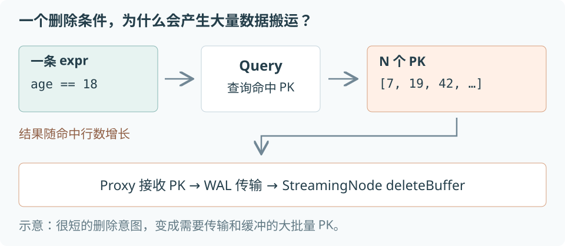

既有压测中，1 亿行、12 CU、并发 Search／Insert 下，删除 2,000 万行耗时 **129.6 秒**；Proxy memory working set 从 **0.53 GiB** 升至 **1.41 GiB**，StreamingNode 从 **4.70 GiB** 升至 **9.51 GiB**。[实验报告](experiments/20261016-bulk-delete/report.md)

predicate delete 的预期收益是：**省去前置 Query 和大批量 PK 传输，降低前台查询、网络与缓冲成本。**

### 2.2 PK inplace-update：避免未修改 raw data 的额外 cache 驻留

当前 partial-upsert 为补齐完整新行，需要 Query 旧行。即使只修改 `checked`，也可能读取未修改的 vector、VARCHAR；随机 PK 分散在不同 CacheCells 中，又会将这些行所在的整块 raw data 载入 cache。**代价不止发生在请求执行期间：请求结束后，这些未修改数据仍可能占用内存。**

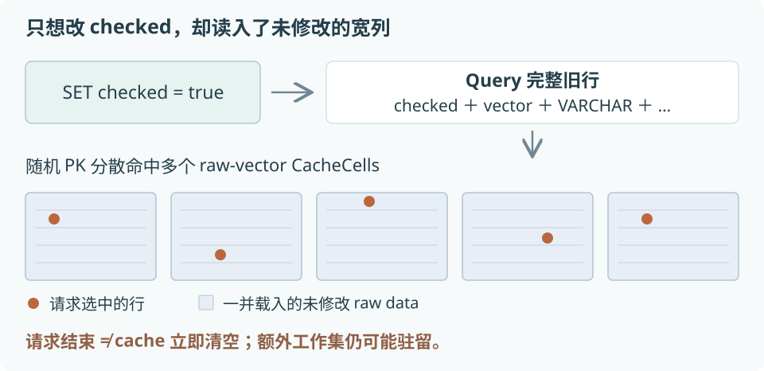

[旧行 Query／partial-upsert 实验](20261030-partial-upsert-query-memory-experiment-zh.md)使用 100 万行、768 维 vector、1 KiB VARCHAR、raw local format。随机读取 **1% 的行**，触及全部 **971 个 raw-vector CacheCells**；Query-only 冷读停止 **120 秒后**，对照调整后的 RSS 仍增加 **2.894–2.904 GiB**。真实 partial-upsert 首次增加 **3.027 GiB**。

PK inplace-update 的预期收益是：**不再为修改小字段读取完整旧行，避免由此拉入未修改宽列的额外工作集。**

### 2.3 PK inplace-update：减少整行重写及额外 vector 维护

当前 partial-upsert 还会将补齐后的完整行作为新版本 Insert，并 Delete 旧版本。只改一个 scalar 字段，也会重复写入未修改的 vector 和宽列，并增加后续 compaction、index build 的处理量。

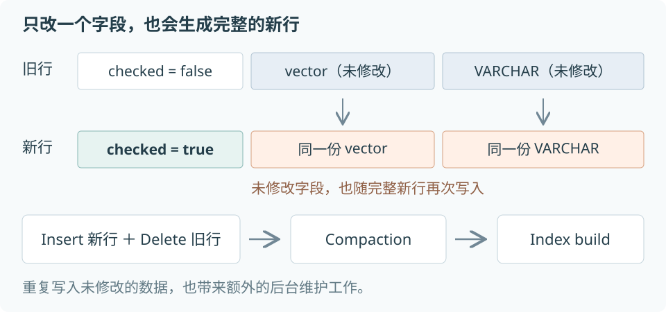

PK inplace-update 的预期收益是：**避免 scalar 变更生成完整新行，减少未修改字段的重复写入，以及由此额外引入的 compaction 和 vector indexing 工作。**

## 3. 顶层设计：一条逻辑时间线，两条消费路径

客户端的 predicate delete 和 PK inplace-update 经 Proxy 写入 WAL。同一份操作随后进入两条链路：持久化链路保存变更并在后台形成新 segment，在线链路更新正在服务的数据。

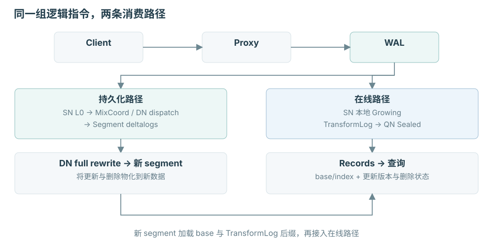

### 3.1 持久化链路：从操作到新 segment

L0 delta 模块中，SN Materializer 将 WAL 中的操作保存为 L0 delta files，MixCoord 接收输出并调度 DN，将变更分发到相关 segments。随后 DN 在 full rewrite compaction 中将变更写入新 segment。

### 3.2 在线链路：从操作到查询结果

StreamingNode 本地 Growing 消费有序 WAL；QN 通过 QueryView 的 TransformLog subscription 接收历史与实时操作，应用到本地 Sealed segments。两者将更新和删除叠加到原数据，使查询看到相应结果。

查询侧加载新 segment 后，接入在线链路并继续接收后续操作。两条链路由此衔接：同一份操作既影响当前查询，也进入后续加载使用的数据。

## 4. 功能约束与模块职责

### 4.1 功能约束

predicate delete 与 PK inplace-update 均允许对 unloaded collection 提交。loaded 时，在线消费者同步 apply 到适用 segments；unloaded 时，后续由 persistence、compaction 和 load replay 执行。API 在 WAL append 成功后返回；需要看到该操作的查询，必须等到相关 apply 完成，不要求返回时所有 replicas 已完成。

| 能力 | Phase 1 语义 |
| --- | --- |
| Predicate delete | 支持 `AND / OR / NOT / > / < / >= / <= / != / == / IN` 的受限 typed expression，可比较 DOUBLE 字段（如 `score > 0.75`）。整棵表达式、字段类型、常量和 NULL 语义均须通过校验 |
| PK inplace-update | 选行支持 `pk == constant` 和 `pk IN [constants...]`；所有目标 PK 应用同一组 assignments，可同时修改多个字段；对每个 PK 更新全部满足 scope、时间和存活条件的物理行，即 update-all-matches |
| 可更新字段 | INT8／16／32／64、BOOL、TIMESTAMPTZ、VARCHAR、普通标量 ARRAY；支持 nullable 字段的显式 SET NULL |
| 赋值方式 | 整 cell 常量 SET；ARRAY 也是提交整个新数组。不同字段的赋值互不覆盖 |
| 不支持 | 通用 UPDATE WHERE、算术赋值、读取旧值的 RHS、ARRAY append/remove 或元素 patch；JSON、VECTOR、TEXT、独立 FLOAT／DOUBLE 字段更新及嵌套／VECTOR／STRUCT 数组 |
| 特殊字段 | 不更新 PK、分区键、聚簇键、函数依赖／生成字段及 TTL 时间字段 |
| 无匹配行 | 不插入、不复活，操作对该 segment 无效果 |
| 请求边界 | 一次请求提交一个 UPDATE 或 DELETE，可包含多个 PK；不新增用户可组合事务，内部沿用现有 VChannel transaction 机制。既有 Upsert 内部事务保持原语义 |
| 物化方式 | 普通 full rewrite compaction；Phase 1 不做数据侧或 QN-local Consolidation |

例如 `SET values=[1,2,3,4]` 表达完整的新数组，而不是“在旧数组上追加 4”。`SET count=100` 受支持，`count=count+1` 不受支持。Proxy 可以保留直接化为 literal SET 的语法便利，但不能隐含查询旧值或新增 read-modify-write 语义。

复用现有 Delete API，合法表达式按以下路径分流：

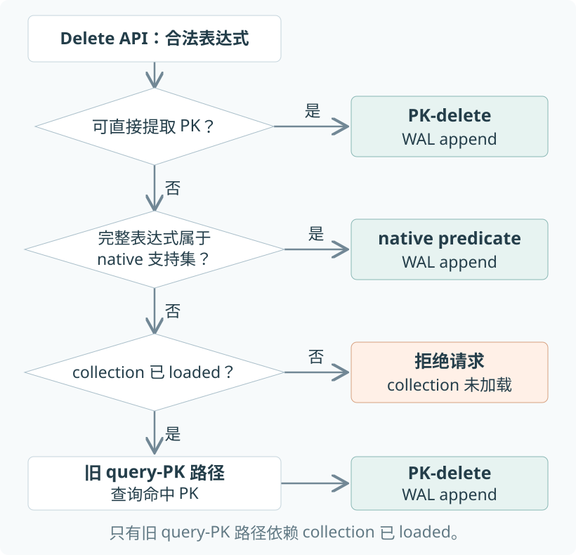

路径在写入前选定，native append 开始后不因超时或 apply 失败回退到 query-PK。

native predicate 在 WAL ACK 时不知道实际命中数。`delete_count` 的 unknown 返回表达是尚需处理的接口兼容项；不为恢复计数增加前台查询，也不能将默认 0 宣称为实际删除数。

### 4.2 模块职责与协作

| 模块 | 输入与输出 | 模块职责 |
| --- | --- | --- |
| Proxy / WAL | API 请求 → WAL 消息 | 校验请求，提交逻辑 mutation |
| L0 delta／MixCoord 调度 | WAL 消息、delta 统计 → segment deltalogs／compaction plan | 生产并分发 L0，结合 delta 统计调度 full rewrite |
| DN full rewrite | base＋deltalogs → 新 segment | 合并 base 与 deltas，写出替代 segment |
| QueryView／TransformLog | WALSummary／实时 WAL → 本地 segments | 交付历史与实时 mutations，完成 catchup 和查询等待 |
| Segment | base/index＋mutations → 查询结果 | 执行更新与删除，提供 overlay 读取 |

下图展示一个 delta 从 Proxy 进入后，如何经各模块分别作用于在线查询和 compaction 输出。

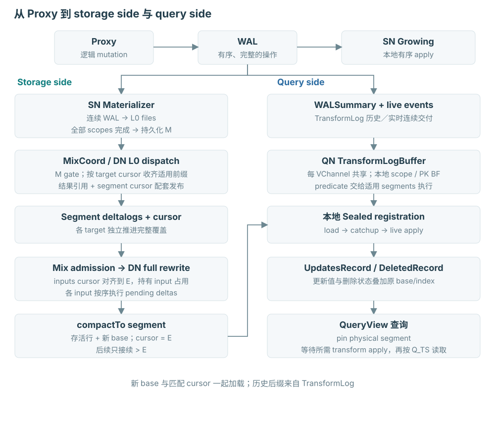

### 4.3 时间与进度的含义

| 记号／字段 | 含义 | 维护位置 |
| --- | --- | --- |
| `row_ts` | 物理行的有效诞生时间，UPDATE 不改变它 | 行数据；导入沿用现有 commit-time 处理 |
| `mutation_ts` | mutation 的有效 WAL TimeTick；transaction 内取 CommitTxn TimeTick | WAL、TransformLog 和 delta record |
| `M` | VChannel 级 delta 持久化发布水位：三类 delta 已完整持久化并登记的连续前缀的结束时间戳 | 复用持久化的 `transform_materialized_time_tick`，供 L0 调度使用 |
| Segment cursor | `transform_start_after_timetick`：加载该版本的 base＋deltalogs 后，TransformLog 从此时间戳之后继续 replay | 与 segment 数据版本绑定的持久化 metadata |
| `E` | 本轮 delta 分发或 cursor-only 推进的完整结束边界；Mix inputs 对齐后，也是输出继承的共同 cursor | 固定在对应任务／compaction plan 中，不新增 VChannel 水位 |
| `catchupFrontier`／`drainedTo` | 前者是本次 catchup 的固定终点；后者是该 physical segment 已完成的 apply 进度 | QN TransformLogBuffer registration 的内存状态 |
| `Q_TS`／`transforming_timetick` | 前者是查询 MVCC timestamp；后者是 QueryMVCC 为该请求确定的 Sealed transform 执行要求 | QueryView 查询计划与执行等待 |

Segment cursor 证明该数据版本已包含截至该时间的全部适用 mutations，或这些 mutations 不影响它；它不表示 QN 已完成 apply。M 管理 L0 生产，segment cursor 管理持久化覆盖，`drainedTo` 管理实际执行，三者分别推进。

## 5. 模块详细设计与实现改造

### 5.1 Proxy / WAL：提交可重放的逻辑操作

Proxy 将用户请求转换为逻辑 mutation；WAL 保存操作并确定消费者使用的逻辑时间。

#### 5.1.1 请求到 WAL 消息

请求在 WAL append 前完成权限、schema、scope 和表达式支持集校验，并选定执行路径：

**Delete API。** 按 §4.1 的规则分流，支持集判断针对最终完整表达式。以下用 SQL 示意：

```sql
-- 支持：直接提取 PK，走 PK-delete
DELETE FROM t WHERE pk IN [100, 200];

-- 支持：完整表达式属于 native predicate 支持集
DELETE FROM t WHERE age >= 18 AND checked == false;

-- 超出 native 支持集：整条表达式尝试旧 query-PK 路径，依赖 collection 已 loaded
DELETE FROM t WHERE age >= 18 AND (name LIKE '%review%' OR name LIKE '%urgent%');
DELETE FROM t WHERE PHRASE_MATCH(description, 'vector database', 1);
```

Phase 1 将 native predicate DELETE 的 predicate 上限设为 **10 KiB**，因为完整 predicate 需要 fan-out 到 scope 内所有适用 segments。Proxy 在 WAL append 前检查编译后的 `proto.Size(predicate) <= 10_240`，超限直接 reject，不拆分表达式。

**Point UPDATE。** 使用独立入口，接受 PK 等值或 PK IN 常量列表与 literal assignments：

```sql
-- 支持：单个 PK 或 PK 列表，赋值为常量
UPDATE t SET checked = true WHERE pk == 100;
UPDATE t SET checked = true, name = 'reviewed' WHERE pk IN [100, 200];

-- 不支持，直接 reject：按非 PK 条件选行，或在 PK 条件外附加业务字段条件
UPDATE t SET checked = true WHERE age >= 18;
UPDATE t SET checked = true WHERE pk IN [100, 200] AND age >= 18;
```

Proxy 直接提取 UPDATE 的 PK 数组，复用 PK-delete 的 VChannel 路由和批量打包方式，无需前置 Query。写入前分别校验赋值：

- 窄整数检查越界。
- VARCHAR 检查 `max_length`。
- ARRAY 检查 `element_type / max_capacity` 及元素有效性。
- TIMESTAMPTZ 沿用 UTC Unix microseconds 归一化。

消息构造按操作类型区分目标表达：predicate delete 将字段名绑定为 field ID 和类型，构造 typed predicate；point UPDATE 直接携带 PK 数组与 typed assignments，不把 PK 等值／IN 条件编码为 expression AST。PK、predicate 和赋值内容均放在 body，结构见 §5.1.2。

消息按 VChannel 打包并 append WAL，复用 VChannel-level transaction 机制：

- predicate DELETE：一次 API 调用携带一个完整 predicate，每个目标 VChannel 写一条逻辑消息，走单消息 autocommit。
- PK IN UPDATE：先按 VChannel 路由，再按包含 assignments 的完整消息大小切分 PK 列表；同一 VChannel 的多条 UPDATE 消息在一个 transaction 中提交，有效 mutation_ts 见 §5.1.3。

#### 5.1.2 WAL 消息格式

WAL 消息包含逻辑操作及其解释上下文：

- predicate delete 携带 typed predicate，point UPDATE 携带 PK 数组与 assignments。
- 每次提交明确 collection、VChannel、partition scope、schema 身份、目标字段和 typed 值。
- 消费者不依赖 Proxy 查出的 offsets 或主集群特有的 segment 布局。

沿用现有 WAL envelope：

- Properties 保存通用属性。
- Header 保存 collection／schema 身份，编码在 `_h` property。
- Body 保存业务内容，以 Protobuf bytes 作为 payload，启用 cipher 时加密 payload。

以下为拟新增消息的解码后逻辑结构。

Predicate delete：`DELETE FROM t WHERE age == 18`，其中 age 的 field ID 为 102。

```text
Properties {
  message_type: PREDICATE_DELETE,
  vchannel: "v1", timetick: 100, txn_context: null
}
Header { collection_id: 10, schema_version: 7 }
Body {
  partition_scope: ALL_PARTITIONS
  predicate {
    unary_range_expr {
      column_info { field_id: 102, data_type: Int64 }
      op: Equal
      value { int64_val: 18 }
    }
  }
}
```

Point update：`UPDATE t SET checked = true, name = 'reviewed' WHERE pk IN [100, 200]`。primary_keys 直接使用现有 `schemapb.IDs` 表达 PK 数组，与 PK-delete 保持相同的字段组织；checked、name 的 field ID 分别为 103、104。

```text
Properties {
  message_type: UPDATE,
  vchannel: "v1", timetick: 110, txn_context: null
}
Header { collection_id: 10, schema_version: 7 }
Body {
  partition_scope: ALL_PARTITIONS
  primary_keys {
    int_id { data: [100, 200] }
  }
  assignments: [
    { field_id: 103, literal: { data_type: Bool, bool_value: true } },
    { field_id: 104, literal: { data_type: VarChar, string_value: "reviewed" } }
  ]
}
```

predicate delete 复用 [planpb.Expr](../../pkg/proto/plan.proto) 的受限节点。

- `UpdateBody` 的 `oneof target` 在 Phase 1 只接受 `primary_keys`，为后续 UPDATE WHERE 预留 `predicate`（`planpb.Expr`）。
- 单 PK 等值请求使用长度为 1 的 PK 数组。
- `literal` 使用 §5.2.4 的 TypedValue，nullable 字段通过显式 `null_value` 表达 SET NULL。

SET NULL：假设 name（field ID=104）是 nullable VARCHAR，`UPDATE t SET name = NULL WHERE pk == 100` 对应：

```text
Properties {
  message_type: UPDATE,
  vchannel: "v1", timetick: 120, txn_context: null
}
Header { collection_id: 10, schema_version: 7 }
Body {
  partition_scope: ALL_PARTITIONS
  primary_keys { int_id { data: [100] } }
  assignments: [
    {
      field_id: 104
      literal { data_type: VarChar, null_value: NULL_VALUE }
    }
  ]
}
```

| 消息内容 | oneof value 状态 | UPDATE 语义 |
| --- | --- | --- |
| `literal { data_type: VarChar, null_value: NULL_VALUE }` | 选中 null_value | SET NULL |
| `literal { data_type: VarChar, string_value: "" }` | 选中 string_value | 设置为空字符串 |
| `literal { data_type: VarChar }` | 未选中任何 value 分支 | 缺少赋值，reject |
| 没有该字段的 assignment | 不涉及该字段 | 不修改 |

校验与执行均检查 **oneof case**；assignment 存在但 value 未设置时，写入端在 WAL append 前 reject，消费端同样拒绝缺值。

#### 5.1.3 有效 TimeTick 与 transaction

在线 apply、L0 delta records 和 compaction 使用同一个 mutation_ts：

```text
mutation_ts = 非 transaction ? message.TimeTick() : CommitTxn.TimeTick()
delta.ts    = mutation_ts
```

例如同一次 UPDATE 请求在 v1 内被切成两条消息：

```text
物理 WAL：BeginTxn@90 → UPDATE@91 → UPDATE@92 → CommitTxn@100
消费与 L0：两条 UPDATE 的全部 delta records 均使用 mutation_ts=100
```

现有 [transaction assembly](../../pkg/streaming/util/message/builder.go) 在消费时将 transaction 及其 body messages 的 TimeTick 统一设为 CommitTxn.TimeTick()。这是 WAL 逻辑时间，不是客户端提交时间或 append 完成的 wall-clock 时间。

#### 5.1.4 CDC 复制

现有 [CDC 复制链路](../agent_guides/streaming-system/replication/replicate.md)转发两类操作的逻辑 WAL message。主备分别消费消息，独立完成行定位、执行和物化。Proxy 的职责边界是：

- 不查询命中行或 offsets，也不感知目标 segment ID、物理文件。
- 不通过 WAL 之外的额外业务 RPC 指示 SN、DN 或 MixCoord 修改数据或 metadata。

若备集群 SN 不认识新增 MessageType，其 [RPC append 入口](../../internal/streamingnode/server/service/handler/producer/produce_server.go)会在调用 `wal.AppendAsync()` 前返回 `unsupported message type`。该消息不写入备集群 WAL，CDC 返回复制失败，复制 checkpoint 不越过该消息。

#### 5.1.5 当前实现与改造

可直接复用：

- [PK-delete 写入链路](../../internal/proxy/dml/task_delete_streaming.go)的 PK 数组路由、打包与 WAL 消息封装。
- [WAL 提交机制](../../internal/distributed/streaming/internal/producer/producer_task.go)的 VChannel 内部 transaction 和 append 成功返回语义。

需要增强：

- 新增 predicate DELETE 和 point UPDATE 的 WAL 消息，校验 typed 赋值和显式 NULL。
- 在 CDC 部署启用前，确认主备 SN 能接收这两种 MessageType，且两侧的查询和持久化消费者均能按相同语义执行。

### 5.2 L0 delta 与 MixCoord compaction 调度

本模块将连续 WAL 中的 mutations 持久化为 L0 delta files，再按完整前缀分发到目标 segment。MixCoord 结合 delta 统计选择 full rewrite 候选。

- SN 切分 sync ranges、写入并登记 L0，推进持久化水位 M。
- MixCoord 中的 L0 调度侧用 M 控制完整前缀分发与 cursor-only 推进；Mix 调度侧只选择 cursor 已对齐的 inputs。
- DN 执行 L0 分发。

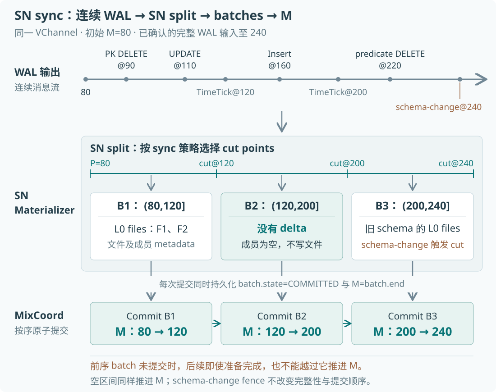

#### 5.2.1 生产侧：SN sync

Materializer 接收同一 VChannel 已确认、按有效 TimeTick 重排的 WAL 消息流，由 SN 切为首尾相接的 sync ranges `(P,E]`。P 是上一段已发布的结束边界；E 必须是完整消费边界，同一 transaction／TimeTick 的 delta 不跨越这个边界；区间内全部 partition scopes 的三类 delta 都须收齐。同一 VChannel 一次只执行一个 sync range，后续消息进入下一段 buffer。

文件按消息携带的 partition scope 组织：

- ALL_PARTITIONS 保留为一个 scope，不展开为具体 partition 列表。
- 每个 scope 按 rolling 策略生成一个或多个 L0，逐个完成文件写入与 metadata 登记。
- 在现有 L0 metadata 中补充所属 sync range 的结束时间戳 `sync_end=E`；同一 range 的所有输出使用同一个 E。`DmlPosition` 保留原有位置语义，不用 records 的末尾位置冒充完整 sync 边界。
- 文件 records 的 min/max ts 仅作内容统计，不是 range contiguous 的证据，也不用于 M gate。

L0 文件保存原始指令，逐条保留 UPDATE。SN Materializer 的输入不含历史 Sealed segments 在 `mutation_ts` 的列值，因此 sync 时无法判断哪些行满足 predicate。

**空区间推进。** <mark style="background-color: #c5c5c5; color: inherit">没有 delta 的完整区间也推进 M，不生成 L0 或空文件。</mark>例如 `M=120`，WAL 已确认消费至 200，且 `(120,200]` 只有 Insert／TimeTick：SN 完成该区间的发布依赖后，只持久化 `M=200`。M 表达完整覆盖边界，不停在最后一条 delta 的 timestamp。连续空区间的 M 更新可合并，但须定期发布，不等待新的 delta 到来；前序 range 仍在 sync 或 retry 时，不能越过它。消费侧据此推进 segment cursor，见 §5.2.3。

**Sync 触发。** 容量、等待时间、显式 Flush 等条件触发 sync；持续无 delta 时也定期发布已确认的覆盖进度。schema-change fence 是强制 cut：旧 schema 的 delta 先 sync，后续 delta 进入新 schema 的 buffer，保证单个文件不跨 schema_version。

- Insert files 独立 sync；发布本轮 L0 前，沿用现有前序 L1 gate，等待该 VChannel 所有 partitions 中在 E 前创建的 L1 完成最终发布或确认退出。

#### 5.2.2 M 发布、retry 与 crash recovery

**以 M 发布完整前缀。** 复用 VChannel metadata 中的 `transform_materialized_time_tick` 作为 M。SN 先完成 `(P,E]` 内全部 scopes 的文件写入和 L0 metadata 登记，再将 M 单调推进至 E 并持久化；不要求将全部 L0 metadata 与 M 放进一个 etcd 事务。

<mark style="background-color: #c5c5c5; color: inherit">L0 compaction 只采用 `sync_end ≤ 已持久化 M` 的有效 L0。</mark>因此文件虽已逐个登记，M 发布前仍不可作为新输入；M 发布后才能取得完整前缀。这里采用 committed watermark 控制消费可见性的原则，类似 [Kafka 只向消费者交付 committed messages](https://kafka.apache.org/44/design/design/#replication)。

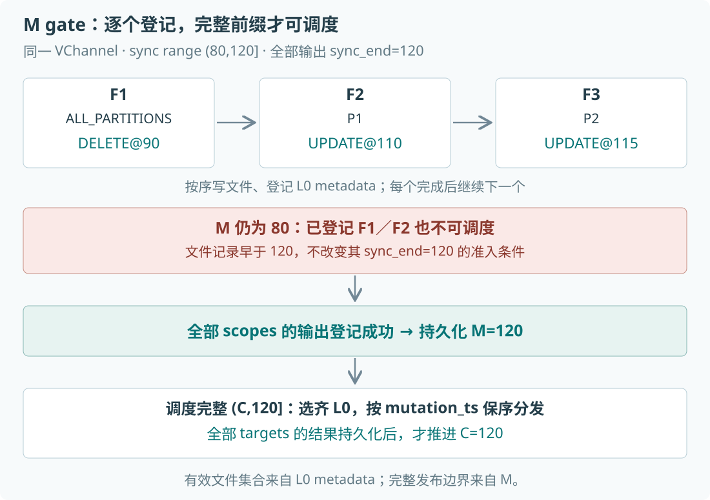

MixCoord 读取 M 时，使用包含该 M 发布前全部 L0 登记结果的 metadata 视图。有效文件集合仍由现有 `SegmentInfo.Deltalogs` 管理，不新增 sync batch header 或成员表。L0 没有自己的 manifest，metadata 保存 LogID，DN 还原文件路径：

| L0 metadata（collection 7） | 所属 sync range 终点 | `Binlog.LogID` | 文件路径 |
| --- | --- | --- | --- |
| `partition_id=10, segment_id=10001` | `sync_end=120` | `9001` | `<root>/delta_log/7/10/10001/9001` |
| `partition_id=10, segment_id=10002` | `sync_end=120` | `9002` | `<root>/delta_log/7/10/10002/9002` |

**正常 retry 只重试失败的 Fn。** 内存中的 materialization task 保留固定 range、已完成位置及各输出 ID。F1 成功、F2 失败时，不重做 F1；F2 复用原 segment ID、LogID 和内容，文件写入及登记保持幂等。F2 成功后才开始 F3。全部输出已完成、仅 M 持久化失败时，只重试 M 发布。

**Crash recovery 丢弃 M 之后的未发布输出。** 新 owner 开始 materialization 前，先阻止旧 owner 继续登记 L0 或推进 M，再读取权威的持久化 M。恢复按下表处理：

| 恢复时的 L0 | 处理方式 |
| --- | --- |
| `sync_end ≤ M` | 沿用已发布输出，继续其分发／GC 生命周期；即使此前 ACK 丢失，也不重写。 |
| `sync_end > M` | 先将这些未发布 L0 持久化标为 `Dropped`，再从 WAL 重建 `ts > M` 的 delta；文件由现有 L0 GC 异步回收。 |

- 旧 owner 的提交权校验覆盖 L0 登记和 M 发布的 metadata 提交，拒绝迟到提交。
- 未发布 L0 的 Dropped 标记可分批重试，全部持久化完成后才启动新的 sync range。
- WAL 仍使用既有恢复位置，Materializer 在 replay 时跳过 `ts≤M`；M 不替代物理 WAL position。

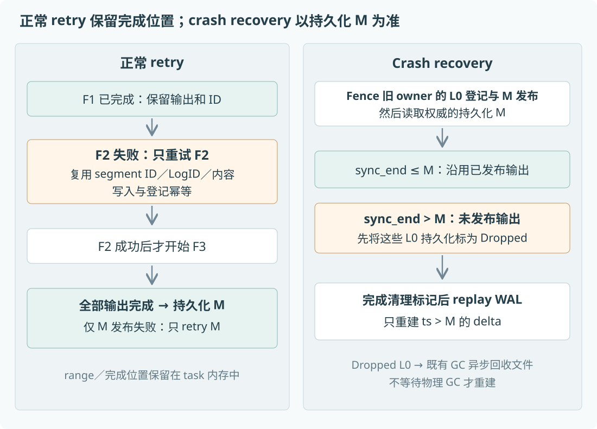

这个方案用 crash 后重写未发布区间的代价，省去独立 batch metadata、发布状态机和 batch GC。提交结果不确定时先读回持久化 M，再决定是否重建，遵循 [etcd 提交确认语义](https://etcd.io/docs/v3.6/learning/api_guarantees/#operation-completed)。

#### 5.2.3 消费侧：完整前缀分发与 cursor 推进

MixCoord 的 L0 调度侧为本轮覆盖选择固定终点 `E ≤ 已持久化 M`。对每个 segment，从它已提交的 cursor 出发，检查 `(cursor,E]` 内全部适用 L0，包含具体 partition 与 ALL_PARTITIONS。需要交付的记录由 DN 按 `mutation_ts` 分发；已证明没有适用记录的区间走 cursor-only 推进。同一 transaction／TimeTick 的记录不能跨越提交边界。

- PK DELETE／point UPDATE 由 DN 按 PK 与 target BF 筛选；UPDATE 保留 PK 列表与共享 assignments。
- predicate DELETE 分发至 scope 内全部适用 targets，在 L0 dispatch 时不求值。
- M 继续推进不改变在途任务的 E，新后缀进入后续任务。

**按 target 提交。** 一个 target 的适用前缀全部持久化后，将 deltalog 文件引用与 `cursor=E` 作为同一数据版本发布。只完成部分文件时不能推进 cursor，也不能向 Mix 暴露可被当作完整输入的部分结果。各 targets 可独立完成；不等待本轮其他 targets 才释放已完成 target 的占用。

**Cursor-only 推进。** <mark style="background-color: #c5c5c5; color: inherit">没有 L0 输入的空区间，以及完整检查后 BF 无命中的区间，都可只持久化推进 segment cursor，不写 deltalog。</mark>推进对象覆盖该 VChannel 中 cursor 落后的有效 Sealed segments，不限于 DN dispatch plan 的 targets。对每个 segment，须根据已持久化 M 和对应的已发布 L0 集合，确认 `(cursor,E]` 已完整交付或不影响该 segment；未被选为 target 本身不构成证明。Cursor 与原有 base／deltalogs 配套发布。

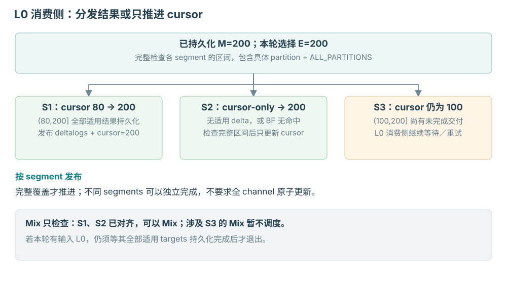

**连续空区间合并 batch。** L0 消费侧将已确认的连续 empty ranges 合并，例如 `(100,120] + (120,150] + (150,200] → (100,200]`，一次 cursor-only batch 将相关 segments 推进到 200。合并不能跨过尚未交付的适用 delta。每个 segment 仍须持久化自己的 cursor；合并减少同一 segment 的重复更新，不要求每次 M 变化都立即更新全部 segments。

- 从最早尚未推进的已确认空区间开始计算合并等待时间，后续空区间到来不重置计时。
- 达到最长合并等待时间后，固定当前已确认的终点 E 并启动 batch；持续没有 delta 也必须触发。
- 最长合并等待时间作为配置项，具体值待定。该上限约束合并等待，不替代完整覆盖和提交成功条件。

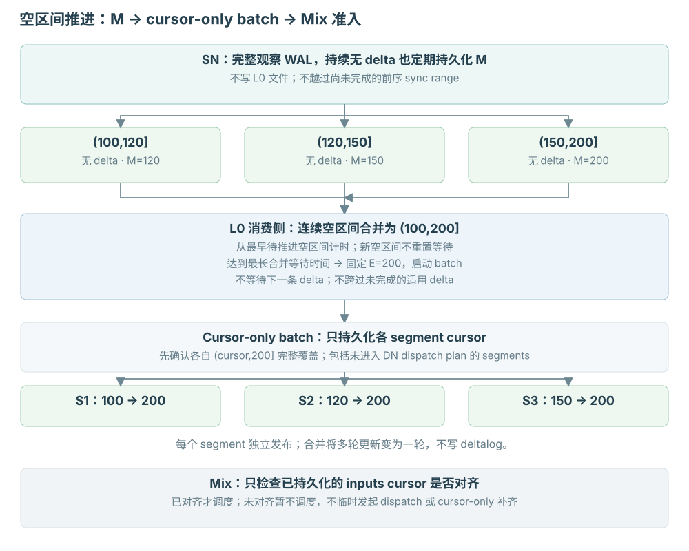

**Mix 按 cursor 对齐准入。** <mark style="background-color: #c5c5c5; color: inherit">Mix 调度只检查 inputs 的 cursor 是否已对齐，不临时发起 dispatch 或 cursor-only 补齐；输出继承共同 cursor E。</mark>未对齐时暂不调度，等待 L0 消费侧独立推进。准入时同时取得这些 inputs 的占用，并固定各自的数据引用与 cursor，避免生成 plan 后又发生覆盖变化。其他未参与 Mix 的 segments 可以继续落后，不需要 range-wide 占用。

例如 S1、S2 的 cursors 均为 200，而 S3 为 100：S1＋S2 可以 Mix，S1＋S3 必须等待 cursor 对齐。若 Mix 对 S1 已执行 `DELETE@110 age=18`（未命中）和 `UPDATE@120 age=18`，而 S3 尚未收到这两条操作，提前合并后再重放旧 DELETE 会误删 S1 来源的行。

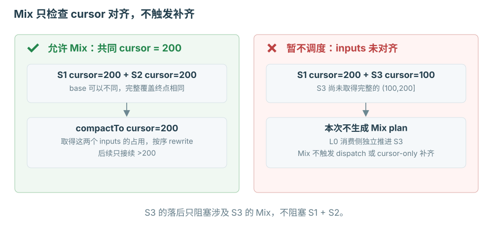

**L0 的退出条件。** Task metadata 固定输入 L0、targets、各 target 的起点与 E，并记录结果提交状态。全部适用 targets 完成持久化交付后，输入 L0 才可标为 Dropped／Compacted。已完成 target 再次遇到相同输入时，跳过 cursor 已覆盖的前缀。

- 同一 segment 的 dispatch／cursor-only 发布与 Mix 互斥；任务恢复依据持久化归属重建占用。
- target 被 Mix 替换后，<mark style="background-color: #c5c5c5; color: inherit">尚未分发的后缀仍须覆盖 new compactTo segment。</mark>旧任务不得向已退出的 input 提交；由 compactTo 的继承 cursor 衔接剩余范围。
- Growing／新发布 L1 的覆盖沿用 §5.2.1 的前序 L1 gate 与现有生命周期约束。

Segment 数据版本和 cursor 共同进入 DataView／QueryView 加载信息，查询侧据此从 TransformLog 取得后缀，见 §5.4。

#### 5.2.4 L0 delta file 格式

使用 Parquet 外层列＋Protobuf payload，服务 storage-side dispatch 与 full rewrite 的 ordered replay。Query side 的历史／实时交付使用 TransformLog，不从独立 L0 files 恢复：

- 每个文件属于一个 collection／VChannel／partition scope，共用一个 schema_version，scope 可为 ALL_PARTITIONS。
- <mark style="background-color: #c5c5c5; color: inherit">旧文件通过 legacy reader adapter 读取，不要求升级时重写。</mark>
- **FileMetadata 是文件级 metadata**，只保存一次，供全部 records 共用。
- **DeltaRecord 是每行 delta 的逻辑格式**，`ts / op_type / pk / primary_keys / payload` 对应 Parquet 列，只有 payload 列保存 serialized Protobuf bytes。

以下为逻辑 schema，具体 wire 字段号在实现中确定。

```text
FileMetadata {
  delta_format_version, schema_version,
  collection_id, vchannel, partition_scope, pk_type
}

DeltaRecord {
  ts, op_type,
  pk: nullable PK,                 // INT64 或 STRING，由文件的 pk_type 决定
  primary_keys: nullable LIST<PK>,
  payload: nullable BYTE_ARRAY  // serialized Protobuf
}
```

| op_type | pk | primary_keys | payload |
| --- | --- | --- | --- |
| PK_DELETE | 单个 PK | 无 | 无 |
| PREDICATE_DELETE | 无 | 无 | `{ predicate: TypedExpr }` |
| POINT_UPDATE | 无 | 本分片的非空 PK 列表 | `{ assignments: Assignment[] }` |
| PREDICATE_UPDATE（**Phase 1 不支持**） | 无 | 无 | 仅预留格式 `{ predicate, assignments }` |

同一次 POINT_UPDATE 在同一 VChannel、partition scope 内按 PK 列表写入 L0，一个分片占一行，只保存一份 assignments。`pk == 100` 写为 `[100]`。长列表可拆成多行，各行保留原操作的 `mutation_ts`，只包含本分片的 PK。

```text
Assignment {
  field_id
  oneof rhs { literal: TypedValue; expression: TypedExpr /* reserved */ }
}
TypedValue {
  data_type
  oneof value {
    int64_value; bool_value; string_value;
    timestamp_us_value; array_value: TypedArrayValue;
    null_value: google.protobuf.NullValue
  }
}
TypedArrayValue { element_type; values; element_validity }
```

- `delta_format_version` 选择协议 reader，schema_version 绑定表达式解释上下文。
- INT8／16／32 即使用 int64 承载，也须保留原类型信息。
- 复用 typed messages 并补齐显式 NULL，保留 `false / 0 / "" / [] / NULL / 未赋值` 的 presence 区别。

**完整混写文件示例。** 以下三次操作写入同一个 L0 delta file，count 的 field ID 为 105：

```sql
UPDATE t SET count = 20 WHERE pk IN [101, 102, 103];  -- mutation_ts = 90
DELETE FROM t WHERE count == 20;         -- mutation_ts = 95
DELETE FROM t WHERE pk == 200;           -- mutation_ts = 100
```

`F1.parquet` 的解码后逻辑内容如下。示例将 payload bytes 展开为 Protobuf 字段，便于阅读；文件仍按 Parquet 列式存储。

```text
FileMetadata {
  delta_format_version: 1
  schema_version: 7
  collection_id: 10
  vchannel: "v1"
  partition_scope: ALL_PARTITIONS
  pk_type: Int64
}

Records [
  {
    ts: 90, op_type: POINT_UPDATE, pk: null, primary_keys: [101, 102, 103]
    payload: {
      assignments: [
        { field_id: 105, literal: { data_type: Int64, int64_value: 20 } }
      ]
    }
  },
  {
    ts: 95, op_type: PREDICATE_DELETE, pk: null, primary_keys: null
    payload: {
      predicate {
        unary_range_expr {
          column_info { field_id: 105, data_type: Int64 }
          op: Equal
          value { int64_val: 20 }
        }
      }
    }
  },
  { ts: 100, op_type: PK_DELETE, pk: 200, primary_keys: null, payload: null }
]
```

本例的三个 PK 路由到同一 VChannel，并写入同一分片。文件共三行，第一行的三个 PK 共用一份 `count = 20`。

- DN 可直接读取外层 ts／op_type／PK 做路由，predicate／assignments 保留 serialized bytes，执行端再解析。
- predicate UPDATE 和 expression RHS 仅预留格式，Phase 1 收到这些分支时返回不支持，不能静默跳过。

#### 5.2.5 MixCoord 重启后如何恢复 L0 分发任务

MixCoord 读取持久化 task 的输入 L0、targets、区间终点 E 和结果状态，结合各 target 的数据版本与 cursor 恢复进度。恢复单位是任务内的 target 交付，不再依赖 VChannel 级分发水位。

Cursor-only batch 的 L0 输入可为空，仍保留目标 segments 与固定终点 E，复用下表的状态判断。已完成的 segment 不重复推进；未完成部分恢复 cursor-only metadata 提交，无需 DN 分发。

| Target 的持久化状态 | 恢复动作 |
| --- | --- |
| cursor 尚未覆盖 E，且 target 仍有效 | 恢复该 target 的任务占用，复用已完成输出并继续剩余分发；完整结果提交后推进 cursor，再释放占用。 |
| 对应数据版本的 cursor 已覆盖 E | 确认已完成交付，不重复追加；补齐 task 完成记录并清理本任务持有的占用。 |
| 原 target 已被 Mix 替换 | 用已提交的 compactTo 关系与继承 cursor 确认覆盖；未覆盖后缀转到当前适用 targets，不向旧 input 补交结果。 |

恢复任务归属后再开放相关 segments 的 Mix 准入。退出顺序为：<mark style="background-color: #c5c5c5; color: inherit">全部适用 target 的结果与 cursor 持久化 → 输入 L0 标 Dropped → 异步 GC。</mark>Task 完成依据保留到 L0 退出已持久化，迟到清理只能释放本任务持有的占用。

未发布 L0 由 §5.2.2 的恢复流程标记 Dropped，不推进 M 或任何 segment cursor。文件清理完成后再删除对应 L0 metadata；未登记的上传产物交给现有 orphan GC。

**升级切换。** 先升级 MixCoord，再升级 SN。新版 MixCoord 接管时按 VChannel 持久化协议切换点，从接管起拒绝旧 SN 新增 legacy L0 登记。接管以旧 MixCoord 已失去 metadata 提交权为前提：切换前已提交的登记保留，在途请求不能在切换后补交。

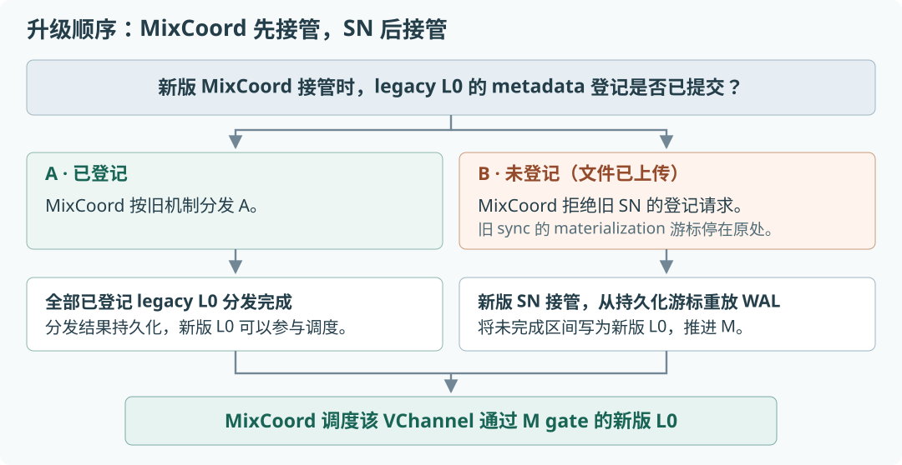

新版 SN 接管后，Proxy 可继续 append 新 delta，SN 可先写入新版 L0 并推进 `M`。该 VChannel 的 legacy L0 分发结果全部持久化后，MixCoord 持久化放行状态并按 M gate 调度新版 delta ranges，文件 GC 可异步进行。

Segment cursor 沿用 QueryView 的初始化与版本校验；未知 cursor 不满足 Mix 对齐条件，不能将两个未知值相等视为覆盖证明。

#### 5.2.6 基于 delta 的 full rewrite 调度

MixCoord 根据实际删除比例、predicate／update 积压及既有文件条件选择 full rewrite 候选。一条 `DELETE WHERE age == 18` 可能删除 100 万行中的 80 万行，也可能没有命中。混写文件中的 `EntriesNum` 还包含 UPDATE records，不能继续用它计算删除比例。

**采集实际删除效果。** MixCoord 通过独立 segment-stats RPC 周期查询 QN，从 loaded sealed segments 的 `DeletedRecord` 获取累计实际删除行数，更新内存 stats cache。采集可复用 QueryCoord 的节点发现与连接，轮询独立于 `GetDataDistribution`，统计变化不推进 distribution version。利用删除统计驱动后台回收的做法可参考 PostgreSQL autovacuum。[PostgreSQL 17](https://www.postgresql.org/docs/17/routine-vacuuming.html#AUTOVACUUM)

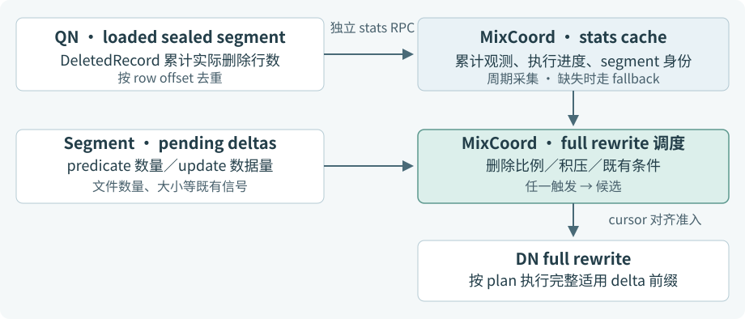

- 观测同时包含 segment／loaded instance 身份、对应的完整 apply 进度、物理总行数和累计删除行数，按 row offset 去重。计数与进度须对应同一个执行状态。
- 同一 segment 按完整 apply 进度选取较新的有效累计观测，替换旧观测；不同 replicas 的计数不累加，也不与 legacy deltalog 的估计删除数相加。
- stats cache 只保留有效的 loaded segment 观测，设定容量与过期边界；MixCoord 重启后重新采集，compactTo segment 独立获取统计。mutation 完成不等待统计采集。

**删除比例信号。** 对满足既有准入条件的 Flushed segment，按 QN 观测可用性使用实际删除比例。

| 候选的统计状态 | 调度行为 |
| --- | --- |
| 有效观测可用 | 用累计删除行数／同一 segment 的物理总行数计算删除比例，结合既有条件选出 full rewrite 候选 |
| Unloaded、尚无报告或观测失效 | 采用适用的文件数量、大小、小 segment 合并等既有条件；不为获取统计而加载 segment，也不将缺失统计当作删除数为零 |

**积压独立触发。** MixCoord 对 pending predicate 数量和 update 数据量分别设置阈值，任一达到阈值即可产生 full rewrite 候选，无须同时满足删除比例条件。该 trigger 基于持久化 delta 积压统计，对 loaded 和 unloaded segments 均生效。

例如 100 条 predicate 全部无命中，实际删除数为零，恢复时仍要执行这 100 条指令。积压统计按逻辑 mutation 去重，QN 在线 apply 完成后仍计入，直到 full rewrite 的输出提交后才清除对应输入的积压。

候选仍须通过 §5.2.3 的 cursor 对齐与 input `isCompacting` 准入。DN 按 compaction plan 执行完整适用前缀，实际删除结果以执行为准。

**待定参数。** Pending predicate 数量和 update 数据量的阈值、统计口径及调度优先级待定。RPC 字段、统计与进度的一致采样、轮询周期和 cache 上限在实现设计中确定。

#### 5.2.7 当前实现与改造

可直接复用：

- [L0 Materializer](https://github.com/milvus-io/milvus/blob/02600c6aa88b2419468defee5452e1768f6ff5c7/internal/streamingnode/server/wal/vchannel/l0materializer/wal.go) 的有序 buffer、串行输出与持久化 M，以及现有 Parquet／legacy reader。
- [L0 结果提交](https://github.com/milvus-io/milvus/blob/02600c6aa88b2419468defee5452e1768f6ff5c7/internal/datacoord/compaction/task/l0_transform.go) 已会结合 M 和剩余 L0 限制 segment cursor，并为已检查但无 PK 命中的 target 更新 cursor；当前推进仍依赖 L0 task 及其返回的 targets。
- 既有 task 生命周期、segment 数据版本发布和 full rewrite policy。

当前 cursor 校验限制的是结果提交时能证明的覆盖边界，**尚未保证 L0 调度只分发完整前缀**。本设计需要增强：

- M 覆盖三类 delta；将普通无 delta 区间纳入定期发布，补充 `sync_end`、schema-change cut 和调度侧 M gate。
- 将整批重做改为只 retry Fn，固定输出 ID；恢复时清理 M 之后未发布 L0，拒绝旧 owner 迟到提交。
- 按各 target cursor 组织完整前缀 dispatch，包括 ALL_PARTITIONS overlap、零输出 cursor 更新，以及结果引用与 cursor 的一致发布。
- 增加不依赖 L0 文件或 DN target 结果的 cursor-only 推进，连续空区间合并 batch，并设置最长合并等待时间，避免无 delta 的 segments 长期停滞。
- Mix 只检查 cursor 对齐，并与 input 占用、plan 快照绑定；补齐由 L0 消费侧独立完成，任务恢复与 L0 GC 按 target 完成状态判断。
- 增加 QN segment-stats RPC、独立轮询与统计 cache，使用实际删除比例；增加 predicate／update 积压的独立 full rewrite trigger。

### 5.3 DN full rewrite：按序物化并替换 segment

DN full rewrite 读取各 input segment 的 base 与适用 deltas，执行更新和删除，将存活行写入新的输出 segment。

#### 5.3.1 输入到重写输出

MixCoord 按 §5.2.3 选择 cursor 已对齐到 E 的 inputs，取得这些 segments 的 `isCompacting` 后，将各 input 的 manifest／deltalog 引用与共同 E 固定在 compaction plan 中。DN 读取本次 plan 指定的数据版本；占用持续到 compactTo metadata 提交，阻止 L0 向这些 inputs 追加 delta。

```text
S1：base₁ ＋ pending deltalogs₁，cursor=200
S2：base₂ ＋ pending deltalogs₂，cursor=200
  → 取得 S1、S2 占用，固定输入版本与 E=200
  → 各 input 按 mutation_ts 执行自己的 pending deltas
  → 写出 compactTo，发布新 base 与 cursor=200
  → 后续 dispatch／TransformLog replay 仅接续 >200
```

**DN 的执行契约。** 上游为每个 input 提供完整、按序的适用前缀。DeltaExecutor 按 `mutation_ts` 从早到晚执行，predicate DELETE 使用前序 UPDATE 生效后的字段值求值。DN 无需重新枚举 L0 验证连续性。

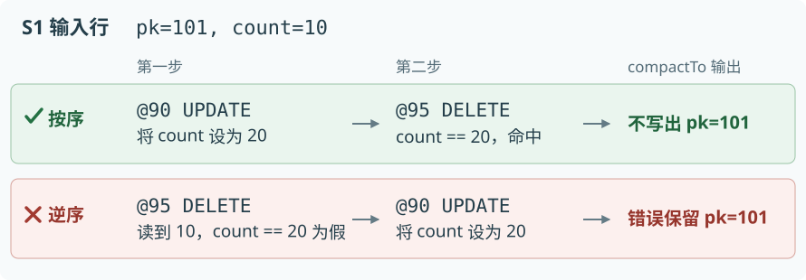

- 对齐的是完整覆盖的结束时间，不是 base：各 input 的 base、行时间范围和 pending records 可以不同。
- DeltaExecutor 以 input segment 为作用域，rows、offsets 与执行状态不跨 input 复用。
- 执行支持同一受限表达式、literal SET、NULL 与时间资格；predicate 仅 TRUE 时删除。

DN 写出更新后的存活行，保留各行的 `row_ts`。<mark style="background-color: #c5c5c5; color: inherit">新 base 与 cursor=E 配套发布，已消化的 predicate 不得再在新 base 上求值。</mark>例如 `DELETE@110 age=18` 原来未命中，`UPDATE@120` 才将 age 改为 18；rewrite 后若从 100 重新 replay，这条旧 DELETE 就会误删。

这里沿用 [Kudu compaction](https://github.com/apache/kudu/blob/1.18.1/docs/design-docs/compaction.md) 固定输入快照、衔接后续 mutations 的原则；本设计通过 input 占用与共同 cursor 完成衔接。

#### 5.3.2 DROP FIELD：block-and-drain gate

**DDL 何时生效。** DROP FIELD 写入各业务 VChannel 的 WAL，以该 VChannel 的 TimeTick `x` 建立 fence。Proxy 和 SN 通过 schema version 校验阻止后续 mutation 引用旧字段，其他字段继续接受写入。

**最细粒度条件（按字段）。** <mark style="background-color: #c5c5c5; color: inherit">只需等 fence 前引用被删字段的 delta：WAL、SN buffer 中的在途记录先 sync 到 L0，再与已有 L0 中的相关记录一起持久化分发到全部适用的 Sealed segments。</mark>

**Phase 1 等待所有适用 targets 完整覆盖 fence。** 对每个业务 VChannel 的 DROP TimeTick `x`，先等 `M ≥ x`，再完成截至 x 的完整 dispatch，使全部适用 targets 的 segment cursor 覆盖 x。判定包含前序 L1 发布和 compactTo 继承关系，不能只抽查当前一部分 segments。这样会一并等待 fence 前的三类 delta，无需分析引用字段；全部完成即可发布新 schema，无需等待 full rewrite。

```text
Phase 1 DDL：各 VChannel 建立 DROP fence x
  → M ≥ x → 全部适用 targets 的 cursor 覆盖 x → 新 schema 生效

S1 下次正常 compaction：读旧列 c → 按序执行历史 delta → 按新 schema 写出存活行
```

**DN 何时物理删列。** 当前 plan 携带目标 schema，没有逐字段的 DROP TimeTick。DN 能识别要移除的列，但仅凭本地 deltalogs 无法判断 `x` 前是否还有 delta 在途。<mark style="background-color: #c5c5c5; color: inherit">若 full rewrite 先写出不含旧列的新 segment，这些 delta 后续到达时就无法执行。</mark>

- **DeltaExecutor 按 execution schema 读。** Phase 1 可以读取 input segment 的全部物理列，保留历史 delta 依赖的字段和类型，按 `mutation_ts` 执行。
- **Writer 按新 schema 写。** DeltaExecutor 处理完更新和删除后，writer 只写存活行，在输出时移除 dropped field。

例如，S1 中有一行 `pk=1, c=5`：

```sql
UPDATE t SET c = 15 WHERE pk == 1;         -- @110
DELETE FROM t WHERE c == 5;               -- @120
UPDATE t SET checked = true WHERE pk == 1; -- @125
ALTER TABLE t DROP COLUMN c;               -- @130，DROP fence：v7 → v8

-- fence 后，仍缓存 v7 的 Proxy 发来旧请求
UPDATE t SET c = 20 WHERE pk == 1;         -- schema_version=7，SN 在 WAL append 前拒绝
```

若在同一 VChannel 的 WAL 中看到这条旧请求以 `mutation_ts=140` 提交，就说明 SN 的 schema version 校验未能拦住它。`DELETE@120` 即使在 fence 后才分发到 S1，仍是合法的历史 delta。

Mix、Sort、clustering 和 [bump-schema rewrite](../../internal/datanode/compactor/bump_schema_version_compactor.go) 在物理删列时都遵守这项读写契约。[ClickHouse](https://github.com/ClickHouse/ClickHouse/blob/master/src/Storages/MergeTree/MergeTreeData.cpp#L13296) 同样保护未完成 mutation 依赖的列。

#### 5.3.3 Backfill：逻辑等价物化与列值覆盖

**External backfill 与 predicate DELETE 的冲突。** L0 保存的是 predicate，DN 在 full rewrite 时还要对它求值一次。如果 backfill 改写了 predicate 读过的列，同一条 DELETE 在线执行和重放时就可能命中不同的行。

<pre><code class="language-text">S1 的所有行都是 age=20，且 row_ts &lt; 100
Query side 执行 <mark style="background-color: #c5c5c5; color: inherit">DELETE@100 WHERE age == 18</mark> → 命中 0 行
External backfill 将 S1 整列 age 填为 18，保留各行原有的 row_ts
DN full rewrite 在新列值上回放 DELETE@100 → 命中 S1 的所有行，整段数据被误删
</code></pre>

这个例子的前提是 `age` 在 backfill 前已可读。如果新列直到 commit 后才允许被引用，历史 predicate 就不会依赖它。

**根因。** [Backfill commit](../../internal/datacoord/services_commit_backfill.go) 通过 CChannel 发布列文件引用，predicate DELETE 则按业务 VChannel 的 TimeTick 执行。两侧的 TimeTick 无法确定 backfill commit 与 DELETE 的相对顺序。DROP FIELD 的 fence 则与 DML 在同一业务 VChannel 上有序，旧列也保留到下次 rewrite，可供 fence 前的 predicate 求值。

**Block + drain + block。** 对可能改写已可见列值的 external backfill，本设计将 backfill 与同一 collection 的 native predicate DELETE 串行执行。

1. **Block**：在相关业务 VChannels 建立 fence，阻止新的 predicate DELETE 进入。
2. **Drain**：收齐 fence 前仍在 WAL、SN buffer、L0、在途 dispatch 和 segment deltalog 中的相关历史。<mark style="background-color: #c5c5c5; color: inherit">DROP FIELD 等到完整分发即可生效。External backfill 必须先在旧 base 上按序执行前序 UPDATE 和历史 predicate DELETE，等 full rewrite 持久化执行结果后，再创建 backfill snapshot。</mark>
3. **保持 Block**：从 Spark prepare 到全部 backfill 结果发布，持续阻止新 predicate。待 QueryView 已切换到 backfill 后的数据版本，或仍使用旧列值的视图已退出服务后，再放行。未加载的 collection 后续从新状态加载。

**同一 cell 的 PK-update（待决）。** 如果 backfill 将某一行的 `age` 写为 18，PK-update 将它写为 21，两者缺少约定的执行顺序，最终值可能是 18 或 21。是否将这类 PK-update 纳入上述 predicate DELETE gate？

**Internal backfill。** 当前 [BumpSchemaVersionCompaction](../../internal/datanode/compactor/bump_schema_version_compactor.go) 不只生成 function outputs，也会物化缺失普通列；移除旧列则走 full rewrite，并遵守 §5.3.2。

普通列的 NULL／default 物化，在同一 schema 下不改变逻辑值：

```text
物化前：age 没有物理列，reader 返回 default=18
物化后：age 物理列保存 18
```

逻辑等价物化不改变 predicate 的命中结果，无需额外作为 UPDATE 排入 delta 时间线；已有 updates／deletes 仍须保留。

- 当前 function-output 物化支持 BM25 的 SparseFloatVector 与 MinHash 的 BinaryVector，均不在 Phase 1 predicate／UPDATE 的支持范围内。

<mark style="background-color: #c5c5c5; color: inherit">若将来 internal backfill 覆盖已可见的 scalar 值，也须遵守 external backfill 的 block + drain + block 约束。</mark>

#### 5.3.4 Mix compaction 后加载 compactTo segment 并释放旧 segment

compactTo 通过 QueryView 加载匹配的新 base、deltalogs 与 cursor=E，再从 TransformLog catchup `>E` 的后缀。即使旧 QN 已执行到 @120，而本次 rewrite 的 E=100，新 physical segment 仍须执行 `(100,120]` 后才能满足相同查询；历史可从 WALSummary 恢复。

- 初始 Records 可为空，加载后缀后会再次积累 histories／deletes。
- 新 base 不保留已折叠的更新历史，沿用 Milvus 的历史查询边界，不新增跨 rewrite 的 UNDO／time-travel。

旧 segment 与 Records 的释放遵守 §5.5.3 的生命周期契约。

#### 5.3.5 当前实现与改造

可直接复用 [Mix compactor](../../internal/datanode/compactor/mix_compactor.go) 的读取、重写输出流程，以及 [EntityFilter](../../internal/compaction/entity_filter.go) 的 PK-delete／TTL 处理。需要增强：

- 增加受限 DeltaExecutor，使 Sort、Mix、clustering 和 schema rewrite 按序执行 predicate delete 与 UPDATE。
- 复用 input 占用保持 rewrite 输入稳定；将共同 cursor E 固定在 plan，输出继承 E。当前 Mix 取输入 cursor 的最小值，需要改为对齐准入后的精确继承。[当前 Mix cursor](https://github.com/milvus-io/milvus/blob/02600c6aa88b2419468defee5452e1768f6ff5c7/internal/datacoord/meta/meta.go#L2671)
- 所有物理删列路径按 execution schema 回放历史 delta，再按 DDL 生效后发布的 write schema 写出。
- 接入 §5.3.3 的持续 gate，完成历史物化、backfill 发布及 query side 切换后才恢复 predicate 准入。

### 5.4 QueryView／TransformLog：历史与实时 mutation 交付

QueryView 为查询固定 schema 与数据资源；TransformLog 将完整、有序的 mutations 交给本地 segments，完成 load catchup、live apply 和查询等待。

#### 5.4.1 从 WAL 到本地 segments

RecoveryStorage 有序观察 WAL，一路更新 SN 本地 Growing，另一路将逻辑 mutations 保存在 WALSummary。QN 通过 TransformLog subscription 获取历史与 live suffix，每个 VChannel 共用一个 TransformLogBuffer，本地 Sealed segments 注册到该 buffer 后接收适用操作。

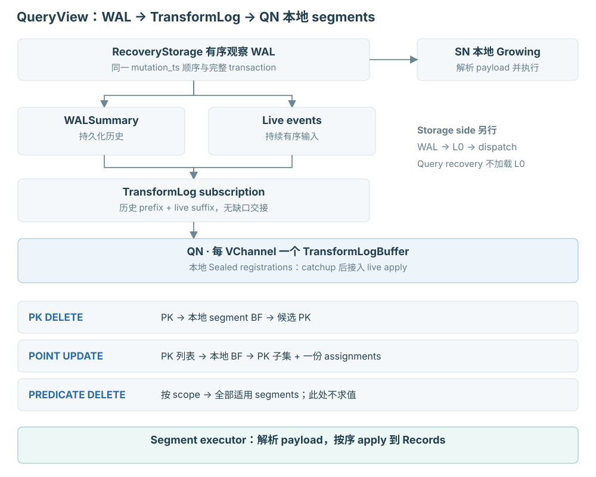

**三类操作在 QN 本地分发。**

- PK DELETE 读取 PK，按 partition scope 和本地 segment BF 筛选候选。
- point UPDATE 逐 PK 做同样筛选。输入 `[101,102,103]` 若仅 101、103 可能命中 S1，就向 S1 交付这两个 PK、一份 assignments bytes 和原 mutation_ts。
- predicate DELETE 将 serialized predicate 交给 scope 内所有适用 segments，执行端解析并求值。

SN 本地 Growing 同样解析并执行 predicate／assignments。SN 不为向远端 Sealed 分发 delta 而持有其 BF；该筛选在 QN 本地完成。

**TransformLog 的消息扩展。** 两种新 mutation 必须同时进入 WALSummary 持久化与 TransformLog 历史／实时编码。外层保留时间、scope 和 PK，predicate／assignments 作为可重复交付的 typed payload；同一 UPDATE 的 PK 列表共用 assignments。Transaction 保留完整操作集合，以 CommitTxn TimeTick 为有效时间，执行完整 entry 后才推进 apply 进度。

#### 5.4.2 Segment load、catchup 与查询等待

加载一个 Sealed segment 时，取得同一数据版本的 **base、deltalogs 与 segment cursor**，先加载 base 并按序执行其中的 deltas，再从 TransformLog replay `>cursor` 的后缀。<mark style="background-color: #c5c5c5; color: inherit">QueryView 不 preload 独立 L0 segments，也不以 L0 files 作为历史缺口的恢复来源。</mark>

TransformLogBuffer 为该 physical segment 固定有限的 `catchupFrontier`，以 `drainedTo` 跟踪实际 apply。Catchup 期间新消息继续保留；历史追平后接入 live dispatch，后续操作不能越过未完成的历史。此机制复用当前 [registration 生命周期](https://github.com/milvus-io/milvus/blob/02600c6aa88b2419468defee5452e1768f6ff5c7/internal/querynodev2/transformlogbuffer/buffer.go)。

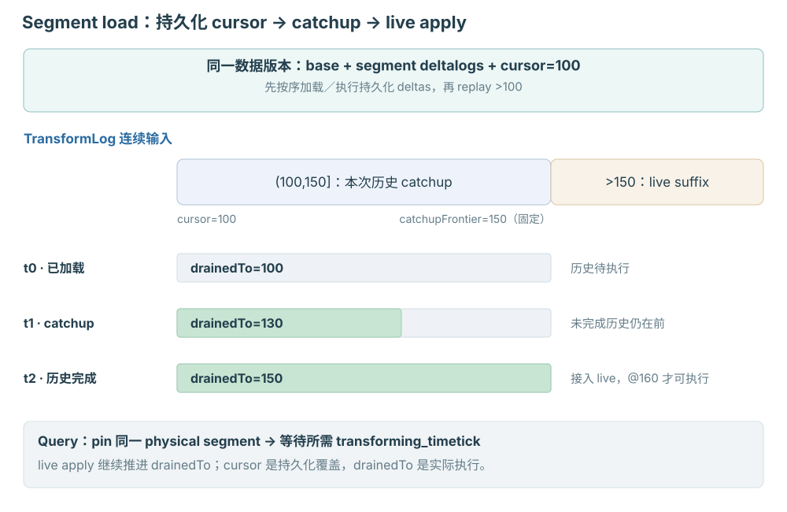

**查询等待实际使用的 physical segment。** QueryMVCC 按请求的一致性要求确定 `Q_TS` 与相应 `transforming_timetick`。QN pin 本次 QueryView 的 physical segment，再通过 `WaitTransformVisible` 等待该实例的 apply 覆盖所需 transform 时间。查询完成前保持同一资源绑定，不能用另一实例的进度代替。

- `catchupFrontier` 用于历史准备，`drainedTo` 用于实际执行；接入 live 后仍按请求要求等待，不以“load 已返回”代替 apply 完成。
- 无 mutation 的区间通过有序 barrier／SyncUp 表达覆盖。查询时间可以晚于最后一条 mutation，不能用 records max ts 推断缺失。
- 若某条 mutation apply 失败，该 physical registration 失效；依赖它的查询失败并触发恢复，不能继续返回旧值。其余 registrations 可以继续消费。

**历史与 buffer 回收。** QN TransformLogBuffer 按仍持有的 QueryViews 和 pending catchup 所需的最早位置保留历史。WALSummary 还须满足后续 reload 与受保护旧视图的历史需求。<mark style="background-color: #c5c5c5; color: inherit">M 推进只证明 L0 已物化，不能据此清理 query-side buffer 或 WALSummary 历史。</mark>回收沿用 QueryView retention。

#### 5.4.3 当前实现与改造

可直接复用：

- [TransformLog subscription](https://github.com/milvus-io/milvus/blob/02600c6aa88b2419468defee5452e1768f6ff5c7/docs/design-docs/design_docs/qviews/pure_transform_subscription.md) 的历史／live 连续交接及共享 buffer。
- [SegmentLoadInfo](https://github.com/milvus-io/milvus/blob/02600c6aa88b2419468defee5452e1768f6ff5c7/internal/datacoord/query_view_segment_load_info.go) 的版本绑定 cursor，以及 [QN load](https://github.com/milvus-io/milvus/blob/02600c6aa88b2419468defee5452e1768f6ff5c7/internal/querynodev2/qvresource/qv_physical_segment_loader.go) 的 base／deltalogs 加载。
- [本地 PK BF 筛选](https://github.com/milvus-io/milvus/blob/02600c6aa88b2419468defee5452e1768f6ff5c7/internal/querynodev2/qvresource/qv_transform_segment.go)、catchup、retention 和 [physical segment 查询等待](https://github.com/milvus-io/milvus/blob/02600c6aa88b2419468defee5452e1768f6ff5c7/internal/querynodev2/qnview/segment_resource_handle.go)。

需要增强：

- 当前 [TransformLog 业务 payload](https://github.com/milvus-io/milvus/blob/02600c6aa88b2419468defee5452e1768f6ff5c7/pkg/streaming/util/message/messageutil/transform_log.go) 只有 PK-delete；增加 predicate DELETE／point UPDATE 的 Summary 持久化、编码和消费，不能将新 mutation 当作无 payload barrier。
- 扩展 [QueryMVCC 消息分类](https://github.com/milvus-io/milvus/blob/02600c6aa88b2419468defee5452e1768f6ff5c7/internal/streamingnode/server/wal/interceptors/timetick/mvcc/query_mvcc.go)，使两种 mutation 都进入 Growing／Transform 执行等待。
- SN Growing 和 QN Sealed 接通同一 mutation 语义；QueryView pin 的 physical base 与其 UpdatesRecord 保持配套。

### 5.5 Segment：执行 mutations，并让查询读取 overlay

Growing／Sealed segment 执行收到的 mutations，并将字段版本和删除结果叠加到原 base/index，供查询读取。

#### 5.5.1 Mutation 执行与 UpdatesRecord

**为什么需要 UpdatesRecord。**

- **版本 history 支持 MVCC。** 为被更新的 cell 保留带 mutation_ts 的版本，让不同 Q_TS 的查询读取各自可见的值。
- **独立 overlay 适配既有 base/index。** Raw data 可能未独立 loaded，loaded scalar index 也缺少通用的原地更新接口，因此保留原 base/index，将更新存入独立 overlay，在读取时合并。

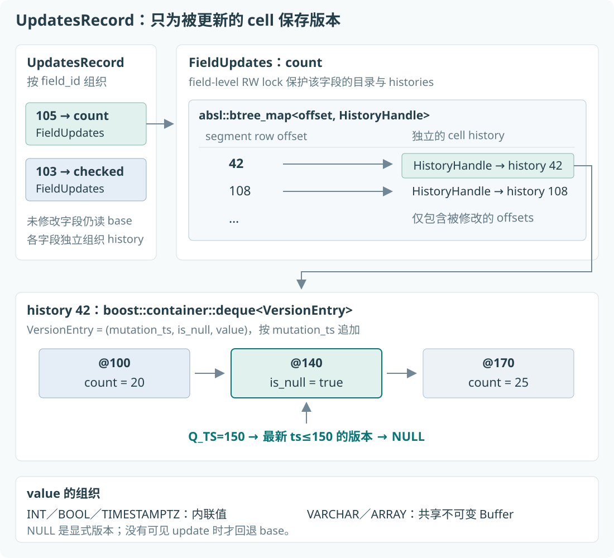

这三层结构分别服务于字段访问、行定位和版本选择，并控制 overlay 的访问与存储开销：

- `field_id → FieldUpdates`：查询只访问相关字段的 overlay，字段级 RW lock 将目录与 histories 的读写竞争限定在各自字段内。
- `absl::btree_map<offset, HistoryHandle>`：兼顾 offset 点查和有序窗口枚举，使批量过滤只遍历当前 row 范围内被更新的 cells；采用 [Abseil B-tree](https://abseil.io/about/design/btree) 的多 key 节点组织，改善目录遍历的 cache locality。
- `boost::container::deque<VersionEntry>`：按 mutation_ts 尾部追加版本，无须搬移已有 entries；[deque 的随机访问](https://www.boost.org/doc/libs/1_81_0/doc/html/boost/container/deque.html) 支持用 `upper_bound(Q_TS)` 二分选择最新 `ts≤Q_TS` 的版本，查找复杂度为 `O(log N)`，N 为该 cell 的版本数。
- History 仅为被更新的 cell 创建，减少稀疏更新时的目录与 history 开销，不复制未修改字段或整行。

每个 `VersionEntry` 保存 `(mutation_ts, is_null, value)`：

- INT／BOOL／TIMESTAMPTZ 的值内联保存，避免逐值分配 Buffer。
- VARCHAR／ARRAY 的同一 assignment 在一个 segment 内命中多行时，各行的 `VersionEntry` 共享一份不可变 Arrow Buffer。查询持有该 Buffer 直到读取完成。
- 显式 SET NULL 追加 `is_null=true` 的版本。空字符串和空数组各自是 `is_null=false` 的值。未赋值的字段不追加版本。

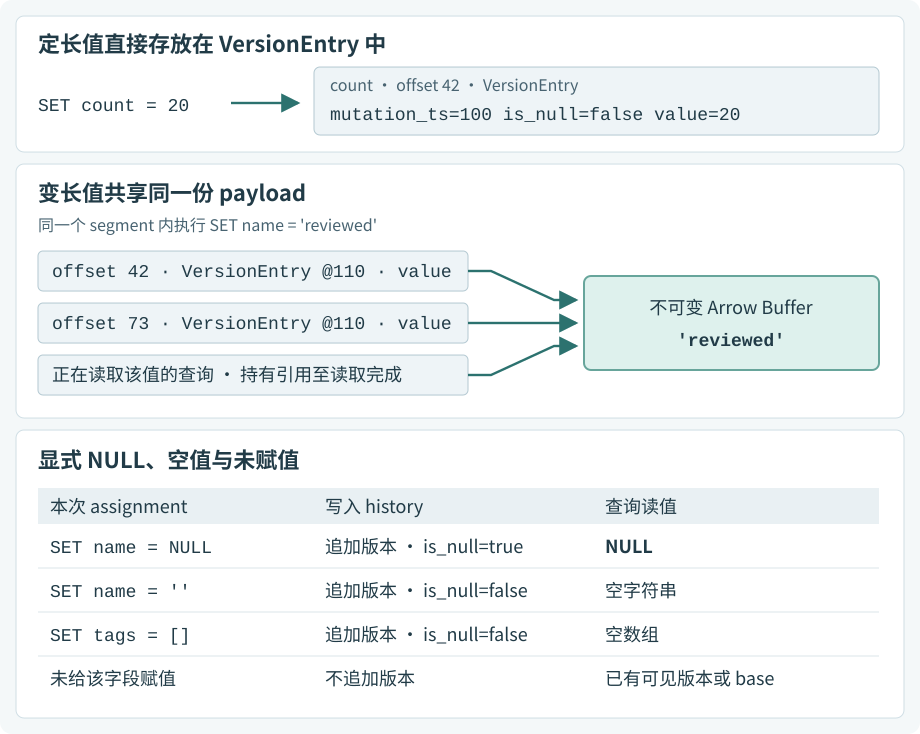

**Segment mutation pipeline。** Growing 和 Sealed segment 按 `mutation_ts` 执行，每条 mutation 按类型选择一条 plan。两种 plan 都只修改 `row_ts < mutation_ts` 且仍存活的行。两类写入都需要目标行，UPDATE 额外携带新值，因此共用拟新增的 `ApplyDeltaNode`。PostgreSQL 的 `ModifyTable` 同样接收目标行并按操作类型执行 DELETE 或 UPDATE。[PostgreSQL 17 源码](https://github.com/postgres/postgres/blob/REL_17_0/src/backend/executor/nodeModifyTable.c#L21-L25)

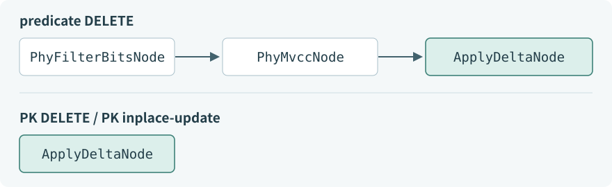

- **predicate DELETE** 先由 `PhyFilterBitsNode` 对 base/index 和前序 `UpdatesRecord` 中的可见值求值，选出 predicate 为 TRUE 的行。`PhyMvccNode` 用 `DeletedRecord` 排除已删除行。`ApplyDeltaNode` 从上游的 bitmap 取得目标 offsets，将 offset 和删除时间写入 `DeletedRecord`。
- **PK DELETE / PK inplace-update** 的消息已携带 `primary_keys`。`ApplyDeltaNode` 可直接调用 segment 的 PK lookup，定位全部匹配 offsets 并检查行时间与存活状态。DELETE 写入 `DeletedRecord`，UPDATE 按 assignments 向 `UpdatesRecord` 追加值或 NULL 版本，保留原 `row_ts`。Kudu 的存储层入口 `DiskRowSet::MutateRow` 同样在内部按 key 定位行，检查存活状态后写入 delta。[Kudu 1.18.1 源码](https://github.com/apache/kudu/blob/1.18.1/src/kudu/tablet/diskrowset.cc#L682-L714)

多字段 apply 通过查询进度保持完整性：需要 @100 的查询在所有字段完成前等待，旧 Q_TS 只读取可见旧版本。后续 mutation 同样不能越过这次未完成操作。

**有序回放。** Segment 信任上游交付前缀的完整性与顺序性。初始持久化 deltas 按序执行后，TransformLog 从匹配的 segment cursor 之后接续；同一 entry 的全部操作完成，registration 才推进 `drainedTo`。BF 无命中或 predicate 未命中也完成该 entry，重复交付只跳过已完整执行的前缀。

#### 5.5.2 Overlay 过滤与取值

Raw 与 Vortex local format 均保持 base/index 的原表示，只描述原字段值。对每个数据访问节点和 Q_TS，先计算 base，再读取可见 delta 并修正结果，查询返回该 Q_TS 对应的 overlay 结果：

```text
B = base 的命中 offsets
U = 当前字段在 Q_TS 下存在可见 update 的 offsets
D = 对 U 的最新可见值重新求值后的命中 offsets

result = (B - U) ∪ D
```

例如 base `count=10`、update `count=20` 时，`count>15` 必须补入该行，反向更新则移除旧命中。<mark style="background-color: #c5c5c5; color: inherit">旧 index 的空命中、min/max 或 all-null 可以剪掉 base 分支，仍须检查 delta</mark>，不能让更新后的命中提前丢失。

**SN 整段 pruning 同样需要覆盖更新。** 若旧 statistics 为 `age∈[10,20]`，UPDATE 将一行改为 100，SN 不能在 QN 执行前就排除 `WHERE age=100` 的 segment。Phase 1 对可更新字段禁用基于旧 statistics 的整段排除；不受更新影响的字段仍可沿用原 pruning。

各类读取入口遵守同一 overlay 规则：

- 字段比较按可见更新修正布尔结果（`result`）及其是否已知（`validity`），再交给 `AND / OR / NOT`。例如 `SET age = NULL` 生效后，`age == 18` 为 `UNKNOWN`，所以 `WHERE NOT (age == 18)` 也不会选中该行。
- 多字段表达式对相关字段 updated offsets 的并集重算，并在同一 Q_TS 取齐值。
- SELECT 优先取可见 update，仅在无可见版本时回退 base，显式 NULL 不回退。
- <mark style="background-color: #c5c5c5; color: inherit">GroupBy、排序、聚合、rerank、字符串／ARRAY 访问和 iterative filtering 等实际取值入口均须接入 overlay。</mark>

上述 overlay 规则可参考 [Kudu REDO deltas](https://github.com/apache/kudu/blob/1.18.1/docs/design-docs/tablet.md)；查询仍沿用 Milvus 现有的重复 PK 去重行为。

#### 5.5.3 Records 生命周期

- QueryView 的 schema/index 更新若复用同一 physical base，不得清空其 UpdatesRecord；切换 physical base 时按该版本 cursor 恢复。
- L0 sync 或分发完成不释放 history，因为 base 尚未吸收更新。

两阶段 Retrieve 先按 `Q_TS` 选出 offsets，再从同一 segment 读取这些 offsets 在 `Q_TS` 可见的字段版本。请求持有 segment pin 直到取值完成。

#### 5.5.4 当前实现与改造

可直接复用：

- [InsertRecord](../../internal/core/src/segcore/InsertRecord.h) 的 PK 定位。
- [DeletedRecord](../../internal/core/src/segcore/DeletedRecord.h) 的删除记录与查询屏蔽。
- 既有 [三值逻辑](../../internal/core/src/common/ValueOp.h)。

需要增强：

- 增加 UpdatesRecord，保存按 Q_TS 读取的字段版本。
- 新增 `ApplyDeltaNode`，支持消费 predicate plan 的 bitmap，或在节点内按 PK 定位行并执行 mutation。
- 接入过滤与取值的 overlay 读取，返回 Q_TS 下可见的更新和删除；SN segment pruning 对可更新字段避免使用旧 statistics 排除整段。
- 提供 §5.2.6 的累计删除统计，保证计数与对应 apply 进度一致，并区分不同 loaded instances。

---

本轮 QueryView、L0 cursor 与 Mix 行为核对基于 master `02600c6a`；相关源码链接固定到该版本。其余既有模块链接保留原设计 worktree 的实现参考。文中“需要增强”均为本设计要求，尚未实现。
